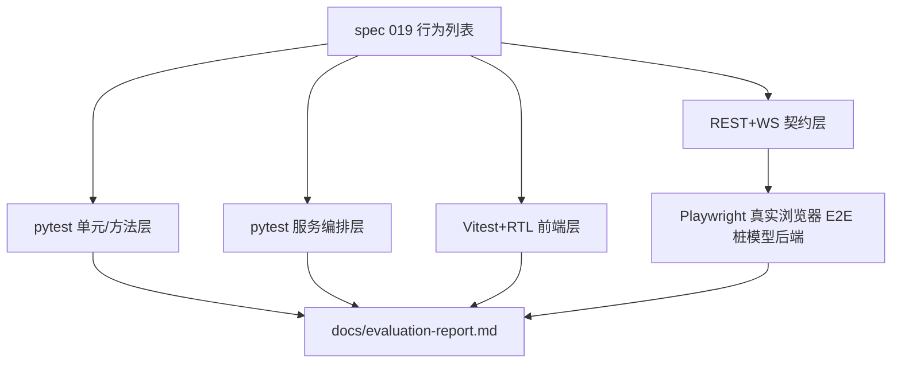

## 用户需求

为 MedSta 全链路补齐自动化测试，并给出项目整体评价与改进建议。

## 产品概述（本次变更形态）

不新增/改造界面，交付物是「可重复执行的测试资产 + 评估报告」：一条命令跑完后端、前端与浏览器端三层测试，失败即定位到具体能力；同时产出一份可评审的项目体检报告。

## 核心功能

- 上传：CSV/XLSX 上传成功画像、扩展名拒绝、空表/脏表/BOM/中文表头、同会话多表、错误提示可见
- 分会话：多会话并存互不污染、会话×工作区绑定与切换、消息与执行记录按 session_id 隔离
- 数据清洗（现有质检能力）：缺失报告（逐列/分组）、四类变量类型推断与用户修正（类型认定后解锁讨论）、七列统计口径、序列索引列排除
- 统计：12 类方法数值正确性、检验策略链（正态性→Levene→失衡→最优/次优）、卡方小期望频数降级 Fisher、Holm/Bonferroni 校正、α 阈值、参数槽位与目标列合法性校验、rationale 必填
- 绘图：11 类图表均可产出有效 PNG、拼图、显著性标注、中文字体缺失时英文回退
- 交付：审阅摘要、表格列/行结构、CSV（UTF-8-SIG）与 XLSX 导出、异常路径 400/404、文件名净化
- 用户交互：WebSocket 全事件契约（type_review→plan→chart_config→progress→review_request→delivered）、流式输出、中断/继续、错误码、未知消息兜底
- 前后端交互：client.ts 请求/错误/WS 发送与解析契约、Vite 代理与 SPA 单端口托管
- 前端布局：桌面双栏（会话流+数据工作区）、窄屏 Tab 切换、会话 Tab 条与工作区 Tab 条、画像表与图表卡片渲染
- 项目评价：按八道门禁 G0–G7 与四块决策板（终点类型/伴发事件/缺失处理/多重性）逐条对照当前能力，输出差距矩阵与 P0/P1/P2 改进建议

## 技术栈选择

沿用现有栈，不引入新运行时：后端 FastAPI + pandas/scipy/statsmodels/matplotlib + pytest（`asyncio_mode=auto`）；前端 React 18 + TS + Vite 5 + Vitest + jsdom + @testing-library/react + user-event；浏览器层 Playwright（Chromium）。报告与文档使用 Markdown。

## 实施方案

### 策略：四层测试金字塔 + 契约优先

1. **单元/方法层（pytest 纯函数）**：`stats/methods.py`、`significance.py`、`plotting.py`、`data/profiler.py`、`data/parser.py`，用固定小样本断言数值/结构，deterministic。
2. **服务编排层（pytest async）**：`SessionService` + `AnalysisWorkflow` + `LocalRecordStore`，沿用现有 `RecordingFakeRequest`/`FakeGateway`（模型在传输边界替换），验证状态机与事件序列。
3. **接口契约层（TestClient REST + WS）**：`POST /sessions`、`POST /data`、`PATCH columns`、`POST activate`、`GET /export`、`/capabilities`、`ws://…/ws/{sid}` 的完整消息契约，是前后端共同真相源。
4. **前端层**：Vitest + RTL 测 `client.ts` 契约与 `App` 布局/交互（mock `fetch` 与 `WebSocket`）；Playwright 起「桩模型后端 + Vite dev」走真实浏览器全流程。

### 关键决策与取舍

- **测试隔离前移**：`routes_data.DATA_ROOT` 当前是模块导入期常量，测试会污染真实 `backend/data/sessions`；改为请求期解析（优先 `request.app.state.data_root`，回退环境变量），`create_app()` 注入 `state.data_root`。向后兼容、零行为变更。给 `SessionManager` 增 `clear()` 供测试清场，避免依赖私有字段。
- **桩模型其后端**：新增 `backend/tests/e2e_app.py` 暴露 `app`（`create_app()` 后把 `app.state.service` 的 agent 换成假网关），Playwright 用它起 8021 端口；**不改生产代码路径**，也不依赖真实 LLM。真模型用例单独文件 + `@pytest.mark.real_llm` + 环境变量门控默认 skip。
- **代理端口可参数化**：`vite.config.ts` 的 proxy target 改为 `process.env.MEDSTA_API ?? "http://localhost:8000"`，E2E 才能与本地 dev 并存（5174→8021）。
- **Playwright 优先、可降级**：先安装 Chromium 跑通；若下载失败或浏览器缺失，则保留 Vitest + RTL 全套并在报告中明确记录降级原因（用户已要求汇报）。
- **数值断言用不变量而非硬编码魔数**：t 检验断言「Welch 在前、p<α 且 Cohen's d 方向一致」，ANOVA 断言「overall + pairwise 且 Holm 校正后 p≥原始 p」，避免实现微调即碎。
- **图表断言用产物契约**：PNG 魔数 `\x89PNG`、文件尺寸>2KB、artifact 为文件名而非绝对路径（历史缺陷回归点）、CJK 缺失时无 `Glyph missing` 告警。
- **性能**：matplotlib 固定 `Agg`；样本 ≤200 行；`tmp_path` 隔离输出；WS 用例全部假模型即时返回，杜绝 sleep 式等待（除中断用例外，用 `asyncio.sleep(0.05)` 上限）；Playwright 仅 1 条串行用例 + 复用单 page。
- **不制造技术债**：所有新测试沿用现有 `pytest.fixture` + 注入式假模型风格；不新建第二套断言库、不引入快照测试（易碎）、不把完整 RCT 流程塞进测试，门禁差距写入报告。

### 架构示意



### 覆盖矩阵（用户诉求 → 落点）

| 诉求 | 主要落点 |
| --- | --- |
| 上传 | `test_upload_contract.py`（成功/拒绝/空表/脏数据/多表） |
| 分会话 | `test_multisession.py`（隔离/绑定/activate/消息与记录分桶） |
| 数据清洗 | `test_profile_quality.py`（missing_report、类型修正、统计口径、index 排除） |
| 统计 | `test_stats_methods.py` + `test_significance.py` + `test_stats_registry` 扩展 |
| 绘图 | `test_plotting.py`（11 类 + 拼图 + 字体回退 + 显著性标注） |
| 交付 | `test_export_delivery.py`（表格结构、CSV/XLSX、404/400、文件名净化、delivered） |
| 用户交互 | `test_ws_contract.py`（全事件链、流式、中断/继续、错误码、未知类型） |
| 前端布局 | `App.layout.test.tsx`（双栏/窄屏 Tab/Tab 条/空态） |
| 前后端交互 | `client.test.ts` + `test_ws_contract.py` + Playwright 全流程 |


## 实施要点（执行注意）

- **先 RED 后 GREEN**：每条行为先写失败断言，再最小修实现（用户已授权修业务代码），修完立即全量回归。
- **测试不得依赖 `.env`**：`create_app()` 在无模型时 agent=None 属正常；真模型用例 `skipif(not os.getenv("MEDSTA_REAL_LLM") or not os.getenv("LLM_API_KEY"))`，并在 `pyproject.toml` 注册 marker 消除告警。
- **WS 用例超时**：用 `client.websocket_connect` 同步上下文配合 `receive_json()`，避免无限阻塞；服务端流式与进度事件允许存在，断言用「集合包含」而非严格顺序等值。
- **前端 mock 边界**：只 mock `fetch` 与 `WebSocket`（网络边界），其余真实渲染；RTL 查询优先 `getByRole/getByText`，确实无稳定文本时才补 `data-testid`（非行为变更）。
- **回归防呆**：保留 `backend/e2e_smoke.py` 作为人工脚本，报告中说明其与自动化用例的关系，避免重复维护。
- **爆炸半径**：生产代码改动限定三处（`routes_data` 数据根解析、`app.create_app` 注入 state、`vite.config` 代理变量），其余全为新增测试/配置；契约（`AnalysisPlan`/WS 事件/`ExecutionReport`/`types.ts`）不改。

## 目录结构（新增/修改清单）

```
/home/xdy/MedSta/
├── spec/implementing/019-full-test-suite.md      # [NEW] 行为列表 B1–B20、硬门/软标、测试映射表；全绿后迁 spec/done/
├── backend/
│   ├── pyproject.toml                            # [MODIFY] 注册 real_llm marker；可选 pytest-cov
│   ├── tests/conftest.py                         # [NEW] 共享夹具：tmp 数据根、假网关、client/ws 工厂、样本 DataFrame、manager 清场
│   ├── tests/test_upload_contract.py             # [NEW] 上传成功/扩展名 400/会话 404/空表/脏数据/多表 dataset_id 唯一
│   ├── tests/test_multisession.py                # [NEW] 双会话隔离、工作区 activate、PATCH 列类型 404/400、记录按 session 分桶
│   ├── tests/test_profile_quality.py             # [NEW] 四类类型推断、七列口径、缺失报告（含 group_by）、类型修正后 type_confirmed 门控
│   ├── tests/test_stats_methods.py               # [NEW] group_compare/anova/chi_square/correlation/regression/logistic/forecast/aggregate_table 数值与结构
│   ├── tests/test_significance.py                # [NEW] α 判定与星号、holm/bonferroni 单调性、attach_significance
│   ├── tests/test_plotting.py                    # [NEW] 11 类 PNG + 拼图 + 字体回退 + pairwise 标注 + default_chart_for
│   ├── tests/test_export_delivery.py             # [NEW] 审阅摘要/表格结构/CSV BOM/XLSX 可读/404/400/标题含斜杠净化
│   ├── tests/test_ws_contract.py                 # [NEW] WS 全事件链端到端、流式、中断/继续、错误码、未知消息、未知会话
│   ├── tests/test_real_llm_smoke.py              # [NEW] 真实模型冒烟，MEDSTA_REAL_LLM=1 才运行，默认 skip
│   ├── tests/e2e_app.py                          # [NEW] 桩模型 app，供 Playwright webServer 使用（不污染生产代码）
│   └── src/medsta/{api/routes_data.py,app.py,session/manager.py}  # [MODIFY] 数据根请求期解析 + state 注入 + clear()
├── frontend/
│   ├── package.json                              # [MODIFY] 新增 test/test:watch/test:e2e 脚本与 devDeps
│   ├── vitest.config.ts                          # [NEW] jsdom 环境、setupFiles、coverage 报告
│   ├── src/test/setup.ts                         # [NEW] jest-dom 注册、fetch/WebSocket 恢复
│   ├── src/test/mocks.ts                         # [NEW] FakeWebSocket + fetch 路由桩（按 URL 返回 fixtures）
│   ├── src/api/client.test.ts                    # [NEW] 能力目录/上传/类型修正/artifactUrl/WS 发送与坏 JSON 容错
│   ├── src/App.layout.test.tsx                   # [NEW] 双栏、窄屏 Tab、会话计数与切换、绑定提示、工作区空态
│   ├── src/App.flow.test.tsx                     # [NEW] 上传→画像→类型确认→方案确认→出图选择→审阅接受/修正→错误卡
│   ├── src/workspace/WorkspacePanel.test.tsx     # [NEW] 表格交付渲染、导出链接、图表卡片、列类型下拉回调
│   ├── vite.config.ts                            # [MODIFY] proxy target 支持 MEDSTA_API 环境变量
│   ├── playwright.config.ts                      # [NEW] webServer 双服务（8021 桩后端 + 5174 dev）、Chromium、trace on failure
│   └── e2e/full-flow.spec.ts + e2e/fixtures/cohort.csv  # [NEW] 浏览器全流程：上传→讨论→确认→执行→交付→导出
├── docs/evaluation-report.md                     # [NEW] 项目评分、G0–G7/决策板差距矩阵、缺陷清单、P0/P1/P2 建议、测试统计
├── docs/{timeline.md,TO_DO.md,design-notes.md}   # [MODIFY] 追加记录、更新清单、记录测试架构决策
├── CODEBUDDY.md                                  # [MODIFY] 纠正过时测试数、补三条测试命令
└── README.md                                     # [MODIFY] 补测试运行说明
```

## 关键结构（契约级）

```python
# backend/tests/conftest.py 提供的最小夹具契约
@pytest.fixture
def data_root(tmp_path, monkeypatch) -> pathlib.Path: ...      # 重定向 MEDSTA_DATA_ROOT + app.state.data_root
@pytest.fixture
def app_client(data_root) -> Iterator[tuple[TestClient, Callable[[str], None]]]: ...  # (client, inject_stub_agent)
@pytest.fixture
def sample_df() -> pandas.DataFrame: ...                        # group/value/outcome 三列标准样本
```

```python
# backend/tests/e2e_app.py 模块契约（Playwright webServer 入口）
app  # FastAPI 实例：create_app() 后注入固定 AnalysisPlan 的桩网关，端口由命令行指定
```

## Agent Extensions

### Skill

- **tdd**
- Purpose: 按 RED→GREEN→REFACTOR 逐条推进 spec 019 的行为列表，保证先失败断言再修实现
- Expected outcome: 每条行为都有对应失败测试记录，随后实现/修复使全量 pytest 与 vitest 转绿
- **playwright-cli**
- Purpose: 安装并驱动 Chromium，编排「上传→讨论→执行→交付→导出」浏览器全流程用例，并在失败时截图定位
- Expected outcome: Playwright 用例可运行；若浏览器下载受限，则给出具体失败证据以支撑降级到 Vitest+RTL 的决策