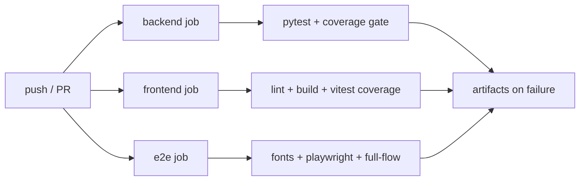

## 用户需求

在 MedSta 已完成测试体系（spec 019）与正确性护栏（spec 020）的基础上，接入持续集成，使「全量回归」从人工执行变为每次推送自动执行并阻断合并。

## 产品概述

不新增界面与业务功能，交付物是可持续运行的工程流水线：代码推送到 GitHub 后自动完成后端测试、前端测试与构建、浏览器端到端测试，并产出覆盖率与失败证据。

## 核心功能

- 仓库初始化：`git init`、补全根忽略规则、首次提交并推送到 `https://github.com/dyy1311/MedSta.git` 的 `main`
- GitHub Actions 三作业流水线：后端 pytest（含覆盖率门槛）、前端 lint/build/vitest、Playwright E2E（安装中文字体）
- 依赖与浏览器缓存、失败时上传 trace/截图/覆盖率报告、同分支并发自动取消
- 本地镜像脚本 `scripts/ci.sh`，在无远端条件下等价验证流水线内容
- 后端覆盖率基线实测，门槛取「实测值向下留 5 个百分点」
- 首次推送后核对 Actions 运行结论；失败则定位修复并重推
- 规范同步：spec 021、时间线、TO_DO、README、CODEBUDDY、设计决策记录

## 边界

- 不引入运行时依赖；`pytest-cov` 仅进 dev extras
- 不接入真实模型（无密钥、不消耗额度），`real_llm` 用例保持默认 skip
- 不做分支保护配置（需 GitHub 后台手动勾选 CI 为必过检查）
- 不修改业务逻辑、不改现有测试断言
- 不使用 force push

## 技术栈

- CI：GitHub Actions（`actions/checkout@v4`、`setup-python@v5`、`setup-node@v4`、`upload-artifact@v4`）
- 后端：Python 3.12、pytest 9、pytest-cov（新增 dev 依赖）、覆盖率门槛 `--cov-fail-under`
- 前端：Node 22、npm ci、Vitest v8 coverage、Playwright + Chromium
- 本地镜像：Bash（`set -euo pipefail`）
- 配置校验：PyYAML（环境中已有 6.0.3，不新增依赖）

## 实施方案

### 策略

以「先可本地复现、再上远端」为原则：先把 CI 内容固化为 `scripts/ci.sh` 并在本机跑通，再把同一组命令映射到 GitHub Actions 的三个并行作业；覆盖率门槛由本地实测值确定，避免首次流水线因拍脑袋阈值变红。

### 关键决策

1. **三作业而非单作业**：后端、前端、E2E 并行，失败定位清晰，总耗时接近最慢的 E2E；E2E 需要 Python 与 Node 双环境，独立成 job 避免污染前后端作业。
2. **缓存策略**：pip 缓存依赖文件 `backend/pyproject.toml`；npm 缓存 `frontend/package-lock.json`；Playwright 浏览器缓存 `~/.cache/ms-playwright`，key 含 lockfile 哈希。系统依赖仍需 `--with-deps`，不缓存。
3. **E2E 中文字体**：Ubuntu runner 默认无 CJK 字体，安装 `fonts-noto-cjk` 以覆盖真实中文图表路径；不安装时绘图会走英文回退，测试仍可通过，但会失去对该路径的验证。
4. **覆盖率门槛**：先执行 `pytest --cov=medsta --cov-report=term-missing` 取语句覆盖率，门槛 `floor(实测) - 5`。只防大幅倒退，不追求数字；前端沿用现有 v8 报告，不设硬阈值以免首日红灯。
5. **首次提交范围**：`git add -A` 前用 `git status --ignored` 核对，确保 `.env`、`backend/data/`、`node_modules/`、`frontend/dist/`、`coverage/`、`test-results/`、`playwright-report/` 均未入库；`.codebuddy/` 保留但按现有忽略策略处理。
6. **远端验证**：首次 push 后通过公开 API `https://api.github.com/repos/dyy1311/MedSta/actions/runs` 轮询最近运行；排队或超时则如实记录，不伪造结论。

### 实施要点

- 所有 job 设置 `timeout-minutes`（backend 15、frontend 15、e2e 25），避免挂死消耗额度。
- 统一 `env`：`PYTHONUNBUFFERED: 1`、`MPLBACKEND: Agg`、`CI: true`（Playwright 配置据此关闭 `reuseExistingServer`）。
- Playwright `webServer` 会执行 `python tests/e2e_app.py --port 8021` 并拉起 Vite 5174，CI 中 `python` 来自 setup-python，无需额外 PATH 配置。
- 上传 artifact 使用 `if: failure()` 与 `if-no-files-found: ignore`，名称按 job 唯一（`backend-coverage`、`frontend-coverage`、`playwright-report`）。
- 本地脚本不执行 `npm ci`（复用现有 node_modules），CI 中必须 `npm ci` 保证锁文件一致。
- 失败重试策略：仅对首次 CI 的环境差异做修复后重推，不对测试本身放宽断言。

### 性能与成本

- 三个 job 并行，缓存命中时后端约 1–2 分钟、前端约 1–2 分钟、E2E 约 2–3 分钟。
- E2E 只跑 2 条串行用例，避免 CI 分钟数膨胀；全量回归的深度由后端/前端作业承担。

## 架构设计



## 目录结构

```
/home/xdy/MedSta/
├── .github/workflows/ci.yml        # [NEW] 三作业流水线：触发/并发/权限/缓存/artifact；backend 跑 pytest+cov 门槛，frontend 跑 lint/build/test:coverage，e2e 装 fonts-noto-cjk 后跑 Playwright
├── scripts/ci.sh                   # [NEW] 本地镜像：定位仓库根、依次跑后端 pytest、前端 lint/build/test、E2E；CI_SKIP_E2E=1 可跳过；任一步失败即非零退出
├── .gitignore                      # [MODIFY] 补根级 coverage/、playwright-report/、test-results/、blob-report/
├── backend/pyproject.toml          # [MODIFY] dev extras 增加 pytest-cov，供 CI 覆盖率门槛使用
├── spec/implementing/021-ci-pipeline.md  # [NEW] 行为列表（流水线结构/本地镜像/覆盖率门槛/首次推送/文档同步）、验收与测试映射；完成后迁 spec/done/
├── docs/timeline.md                # [MODIFY] 追加 2026-10-21 spec 021 记录（含门槛值与 Actions 结论）
├── docs/design-notes.md            # [MODIFY] 记录三作业拆分、缓存、字体、覆盖率门槛的取舍
├── docs/evaluation-report.md       # [MODIFY] 在工程质量一节标注 CI 已接入与限制
├── TO_DO.md                        # [MODIFY] 标记 CI 完成；补「分支保护待手动配置」
├── README.md                       # [MODIFY] 增加 CI 说明与本地镜像命令
└── CODEBUDDY.md                    # [MODIFY] 补 CI 命令、pytest-cov、首次推送与分支保护说明
```

## 关键结构

```
# .github/workflows/ci.yml（结构契约）
name: CI
on:
  push: { branches: [main] }
  pull_request:
  workflow_dispatch:
concurrency:
  group: ci-${{ github.ref }}
  cancel-in-progress: true
permissions:
  contents: read
jobs:
  backend:   # setup-python 3.12 + pip cache
  frontend:  # setup-node 22 + npm cache
  e2e:       # python + node + fonts-noto-cjk + chromium
```

```
# scripts/ci.sh（行为契约）
set -euo pipefail
# 1) cd backend && python -m pytest
# 2) cd frontend && npm run lint && npm run build && npm test
# 3) npm run test:e2e（CI_SKIP_E2E=1 时跳过）
# 任一步失败立即退出，退出码透传
```

## 验收标准

- [硬门] `bash scripts/ci.sh` 本地退出码 0（后端 199 passed + 1 skip、前端 35 passed、E2E 2 passed）
- [硬门] `python -c "import yaml; yaml.safe_load(open('.github/workflows/ci.yml'))"` 解析通过，且三个 job 均存在
- [硬门] 首次提交中不含 `.env`、`backend/data/`、`node_modules/`、`frontend/dist/`、`coverage/`、`test-results/`
- [硬门] `git push -u origin main` 成功，远端 `main` 指向本地提交
- [软标] GitHub Actions 首次运行结论为 success；失败则按日志修复后重推并记录
- [说明] 分支保护需在 GitHub 后台手动配置，报告与 TO_DO 中明确标注