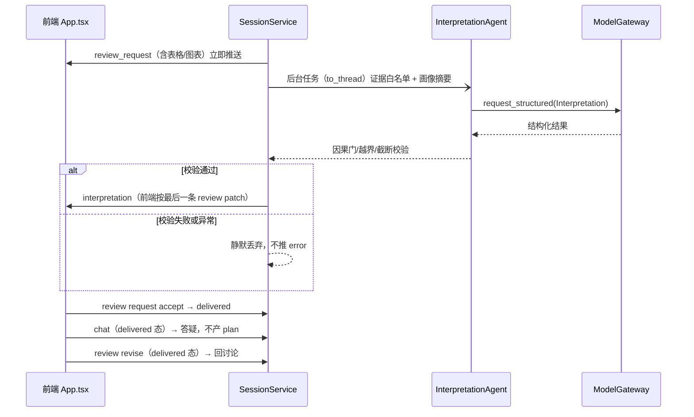

## 用户需求

在现有 MedSta 工作台补齐「结果解释」这一产品闭环缺口：分析执行完成并生成审阅卡后，由宿主把统计结果整理成证据表注入模型，模型只负责撰写受控自然语言解读，随审阅卡内嵌展示，不阻塞既有看表、看图、交付流程。同时修复交付态下追问会误触发重新出方案的缺陷。

## 产品概述

用户确认方案后系统执行并推送审阅卡；随后后台生成解读，以「一条汇总 + 每步一句结论 + 全局提醒」的形式补进同一张卡片。解读只允许引用宿主给出的数值，出现因果断言即被拒绝重试，仍不合规则整段不展示。交付后用户可继续追问，系统按答疑回应；只有明确点击「调整分析方案」才回到方案生成。

## 核心功能

- 证据注入：宿主按统计方法抽取结论性数值与失败原因，附带数据画像摘要与步骤依据，不传原始数据
- 受控解读：每步默认一句结论（上限可配置 1–5），汇总加全局注意事项；固定标注本次为探索性分析
- 两道校验：因果断言硬拦截并重试降级；未经核验的数字保留但在卡片上标记
- 非阻塞推送：审阅卡照常立即出现，解读随后补入；生成失败静默降级，不影响交付
- 开关与粒度：可整体关闭解读；可配置每步最大句数，超限按句边界截断
- 答疑分流：交付后的提问走答疑不重新出方案，显式操作才回到方案调整

## 视觉效果

审阅卡内每步标题下多一行结论文字；卡片底部一条浅色提醒条列出全局注意事项；未核验数值带小型角标；交付态卡片提供「调整分析方案」入口，输入框提示语随状态切换。

## Tech Stack Selection

全部沿用现有栈，不引入新依赖：

- 后端：Python 3.10+ / FastAPI / pydantic v2 / Agently（`ModelGateway` 四段式）/ pandas
- 前端：React 18 + TypeScript + Tailwind 3 + Vitest/RTL + Playwright
- 测试：pytest（`request_factory` 注入假模型于传输边界）

新增的只有逻辑代码，无 `pyproject.toml`/`package.json` 变更。

## Implementation Approach

### 核心策略：宿主给证据，模型写句子，两级校验把关

三个关键决策：

**1. 双事件、非阻塞。** `review_request` 保持立即推送（`service.py:368`），解释作为后台任务生成，成功后推新事件 `interpretation`。若先等解释再推，用户要多等 5–15 秒才能看到表和图——用既有好体验换新增价值不划算。解释失败**完全静默**（不推 error），因为它是增强项，不能成为交付链路的故障源。

**2. 证据抽取走白名单，不给整份 `result`。** `StepResult.result` 是各方法自行拼装的 dict，键不统一。宿主按 method 建表取固定键，并给每个数值分配 ref 编号。这是「全量数据塞 prompt」反模式的直接防线，也让 prompt 体积恒定在 1–2k tokens。

**3. 校验分两级，严格度不同。** 数值是**软标**（出现证据外数字只标记不拒绝，因为模型会做四舍五入、<0.001 这类合法改写）；因果断言是**硬门**（零容忍，命中即重试，再失败整段丢弃）。硬门的判定使用「主语 + 因果动词」模式而非裸词，避免误伤「不能说明存在因果关系」这类正确表述。

**`report_id` 不引入。** 前端复用 `delivered` 已验证的「最后一条 review」定位法（`App.tsx:156-162`）：补绘图走 `updated:true` 不 append 新 review，修正重跑会 append，定位天然正确。后端用步骤签名比对防串台。

### 答疑分流：复用状态机，不加新状态字典

不在 `SessionService` 里加 `_revise_mode` 这类自定义状态（违反架构约束）。改为：

- `_on_chat` 前置判定 `session.status == SessionStatus.DELIVERED` → 走 `_answer`（不产 plan、不改状态）
- 「调整分析方案」复用现有 `review {decision:"revise"}` 事件，扩展 `_on_review` 的 revise 分支：当 `execution is None` 且 `status == DELIVERED` 时，`transition(DISCUSSING)` + 推 `back_to_discussion`，不返回 `NO_ACTIVE_RUN`

这样状态真相仍在 `SessionManager`，前端无需新增意图参数（避免客户端决定服务端路由）。

### 异步与并发

`ModelGateway.request_structured` 是同步阻塞的（`request.start()`），而 service 全是 async。解释任务必须 `await asyncio.to_thread(agent.interpret, ...)`，否则会阻塞事件循环——这是本次唯一真正需要小心的地方。答疑同理。

竞态用步骤签名防护：生成时记录 `[(method, title) for step in report["steps"]]`，回来时与当前 `self._reports[session_id]` 比对，不一致直接丢弃（新执行已覆盖）。同时 `_on_review` 的 revise 分支与 `_on_interrupt` 主动取消解释任务。

### 句数控制

`MEDSTA_INTERPRET_MAX_SENTENCES` 默认 1，clamp 到 1–5。提示词声明上限，宿主按 `(?<=[。！？])` 切分并在句边界截断（不用英文句点，避免误切小数）。截断是确定性的、可测的，优于让模型自行遵守。

## Implementation Notes

- **因果守卫的定位必须在 `docs/design-notes.md` 写清**：它是合规安全守卫（与 schema 校验同类），不是「用正则做语义判断/路由」。实现上先匹配 `(因素|干预|治疗|用药|分组|暴露|变量|指标)` + 0–12 字 + `(导致|引起|造成|使得|决定了|证明了|致使|带来了)`，再检查匹配点前 12 字内是否有 `不能|无法|不足以|并不|未|不应|不可` 予以豁免。
- **未核验数值要防误报**：对每个证据数值 `e` 生成 `round(e, k) for k in 0..3` 的允许集，`0.0287` 因此接受 `0.029` 与 `0.03`；`p<0.001` 形式单独放行。否则误报率高到角标失去意义。
- **模型调用成本**：每次执行 +1 次调用（约 2–4k 输出 token），`MEDSTA_INTERPRET=0` 可整体关闭。
- **契约同步**：`spec/done/006-session-api.md` 的 WS 事件表需补 `interpretation` 与交付态 revise 语义；`frontend/src/types.ts` 的 `WsEvent`/`ChatMessage`/`ExecutionReport` 三处同步，否则 TS 联合类型收窄会漏。
- **不触碰数值链路**：解释只读 `report`，绝不写回 `result`/`table`。回归测试用对象快照比对 `report["steps"]` 前后一致。
- **日志**：沿用现有 `print` 风格并加 `[interpret]` 前缀（本项目 P2 才统一改 `logging`，本次不越界重构）；失败路径只记 `type(exc).__name__`，不打印 payload 与密钥。
- **测试隔离**：沿用 `conftest.py` 的 `RecordingFakeRequest`，解释 agent 走同款 `request_factory`；不得写真实 `backend/data`，不得依赖 `.env`（开关通过显式构造 `InterpretConfig` 注入）。

## Architecture Design



职责边界：`InterpretationAgent` 只做「证据 → 句子」，校验与副作用全在宿主（`interpretation.py` 的校验函数 + `service.py` 的编排）。前端只负责展示与 patch，不参与判定。

## Directory Structure

```
backend/src/medsta/
├── agents/
│   └── interpretation.py          # [NEW] InterpretationAgent：interpret/answer 两个方法，
│                                  #       共用 gateway 与 request_factory 双路径（对齐 DiscussionAgent:105-212 写法）。
│                                  #       含 _EVIDENCE_KEYS 白名单表、_OUTPUT_FIELDS 两套、
│                                  #       因果守卫 _causal_violation、句数截断 _truncate_sentences、
│                                  #       未核验数值 _unverified_numbers、固定探索性 caveat 常量。
│                                  #       interpret 返回 Interpretation；answer 返回 AnswerReply。
├── config.py                      # [MODIFY] 新增 InterpretConfig dataclass（enabled/max_sentences），
│                                  #       from_env 读取 MEDSTA_INTERPRET（默认开，0/false/off 关闭）
│                                  #       与 MEDSTA_INTERPRET_MAX_SENTENCES（默认 1，clamp 1-5）。
│                                  #       与 ProviderConfig 并列，便于测试显式注入。
├── session/service.py             # [MODIFY] 三处接线：
│                                  #       (1) __init__ 加 interpret_agent/interpret_config 参数与 _interpret_tasks 句柄表；
│                                  #       (2) _execute_plan:368 之后启动 _start_interpretation（开关+agent+去重判定，
│                                  #           步骤签名快照，失败静默）；新增 _interpret 协程（to_thread 调 agent）；
│                                  #       (3) _on_chat 前置 delivered 分流到新增 _answer；
│                                  #           _on_review 扩展 delivered 态 revise 分支（execution is None 时回讨论）；
│                                  #           _on_interrupt 取消解释任务。
├── app.py                         # [MODIFY] _build_service 装配 InterpretationAgent 与 InterpretConfig；
│                                  #       模型未配置时 interpret_agent 置 None（解释静默关闭）。
└── pipeline/executor.py           # [不改] 仅作为证据来源读取 StepResult

backend/tests/
├── test_interpretation.py         # [NEW] 证据抽取白名单、因果守卫（含否定语境豁免）、句数截断与 clamp、
│                                  #       未核验数值标记、step_index 越界丢弃、schema 不合规重试降级、
│                                  #       模型异常静默、report.steps 快照不变。
└── test_qa_flow.py                # [NEW] WS 契约：解释事件推送、delivered 态 chat 走答疑不改状态、
│                                  #       delivered 态 revise 回讨论、后续 chat 恢复产 plan、
│                                  #       MEDSTA_INTERPRET=0 时不推解释帧。

frontend/src/
├── types.ts                       # [MODIFY] 新增 StepInterpretation / Interpretation；
│                                  #       ExecutionReport 加 interpretation?；
│                                  #       WsEvent 加 interpretation；ChatMessage 加 answer。
├── App.tsx                        # [MODIFY] 新增 case "interpretation"：按 lastIndexOf("review") patch
│                                  #       （复用 :156-162 手法），事件无 kind 不入消息流；
│                                  #       新增 case "answer" 入消息流；handleSend 在 delivered 态不发 thinking 相位。
├── chat/ReviewCard.tsx            # [MODIFY] 每步标题下渲染 finding（含未核验角标）；
│                                  #       底部 caveats 提醒条（与 :59-64 的 multiplicity_warning 并列）；
│                                  #       delivered 分支 :99-102 改为「调整分析方案」按钮 + 提问提示。
├── chat/AnswerCard.tsx            # [NEW] 答疑气泡：与 notice 区分，左侧竖线表明「回答」语义。
├── chat/ChatPanel.tsx             # [MODIFY] 渲染 answer 消息；placeholder 按 delivered 态切换。
├── chat/ReviewCard.interpretation.test.tsx  # [NEW] 解释渲染、角标、caveats、按钮回调。
└── App.interpretation.test.tsx     # [MODIFY 现有 App.flow.test.tsx] 事件 patch 不污染历史卡片。

spec/ docs/
├── spec/draft/022-result-interpretation.md   # [NEW] 按 templates/spec-template.md 填行为列表与验收分类
├── spec/done/006-session-api.md              # [MODIFY] WS 事件表补 interpretation、交付态 revise 语义
├── docs/design-notes.md                      # [MODIFY] 因果守卫定位、答疑分流归属状态机、证据白名单原则
├── docs/timeline.md                          # [MODIFY] 追加 022 流转行
├── TO_DO.md                                  # [MODIFY] P0 第 6 项移入已完成，更新进行中
└── .env.example                              # [MODIFY] 补两个新变量与注释
```

## Key Code Structures

```python
class StepInterpretation(BaseModel):
    step_index: int          # 必须落在 report.steps 范围内，越界即丢弃该条
    finding: str             # 默认一句；超上限按句边界截断
    caveat: str = ""

class Interpretation(BaseModel):
    summary: str
    steps: list[StepInterpretation]
    caveats: list[str] = []      # 宿主追加固定探索性声明
    unverified_numbers: list[str] = []   # 宿主计算，非模型输出

class InterpretationAgent:
    def interpret(
        self, *, report: dict, plan: AnalysisPlan, profile: TableProfile,
        config: InterpretConfig,
    ) -> Interpretation: ...

    def answer(
        self, *, question: str, report: dict, plan: AnalysisPlan, profile: TableProfile,
    ) -> AnswerReply: ...
```

`unverified_numbers` 是宿主字段而非模型字段，必须从 `_OUTPUT_FIELDS` 排除（避免「未经消费的输出字段」反模式）。

## Agent Extensions

### Skill

- **agently-design**
- Purpose: 在动手前确定 `InterpretationAgent` 的模型/Host 职责边界——哪些交给模型（句子组织）、哪些留给宿主（证据抽取、schema 校验、因果拦截、截断、状态流转），并校验 `interpret`/`answer` 两个请求族的 input/info/instruct/output 是否完整且无冗余。
- Expected outcome: 一份定稿的契约说明（四段式字段表 + 职责归属），直接落进 `spec/draft/022-result-interpretation.md` 的「契约与测试映射」章节，避免实现阶段反复改 schema。

- **tdd**
- Purpose: 按项目强制的 red-green-refactor 垂直切片推进：一条行为一个测试先确认 RED，再写最小实现转 GREEN，禁止先写全部测试。
- Expected outcome: `spec/draft/022-result-interpretation.md` 的行为列表逐条勾选完成，每条都有对应的 RED→GREEN 记录，且后端新增用例不拉低 83% 覆盖率门槛。