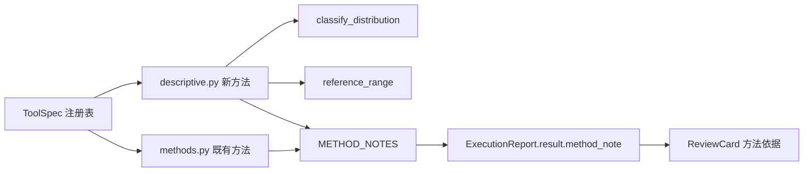

## 产品概述

按《医学统计学》（第8版，李康、贺佳）第二、三、十一章的规范，校准 MedSta 的统计工具链。目标不是增加方法数量，而是让已有结果的数值口径、指标选择与文字说明都能对得上教材，并把教材要求但项目缺失的基础描述与参考值范围补上。

## 核心功能

- **准确性修正**：均值差 95%CI 改用 t 临界值（Welch/配对自由度），非参数路径改用中位数差与 bootstrap 区间；配对 t 检验改为对「差值」做正态性检验；修正 describe 声称输出标准差却未实现的目录文案。
- **新增「统计描述」工具**：逐列输出 n、均数、标准差、变异系数、中位数、四分位数、IQR、极差、众数、偏度、几何均数；宿主按分布形态（正态/对数正态/偏态/样本不足）判定，并给出推荐表述（x̄±s、M(P25~P75)、G）与理由。支持按分组列分层。
- **新增「医学参考值范围」工具**：正态法、百分位数法、对数正态法三种；百分数 90/95/99；双侧/单侧下限/单侧上限；样本量不足时给出稳定性警示。
- **相关与回归增强**：相关系数附决定系数 r²、按教材分档的相关强度、以及「相关不等于因果」的固定提示；线性回归补方差分析表（SS 总/回归/残差、MS、F）与残差诊断（正态性、等方差、样本量与特征数之比）。
- **方法学说明**：每个统计方法的输出附一段由宿主写入的教材口径说明（章节与公式编号、适用条件、解读禁忌），随审阅卡展示。
- **契约一致性**：新增方法同步模型方法枚举与工具注册表，并加入一致性测试，杜绝「注册表有、模型枚举无」导致输出被拒。

## 视觉与交互

审阅卡每一步下方增加一行可折叠的「方法依据」，默认收起，展开显示教材说明；统计交付表按新工具自动增加标准差、CV、IQR 等列；参考值范围以单行表格交付（下限/上限/方法/样本量）。数据画像区保持不变。

## Tech Stack Selection

完全沿用现有栈，不引入新依赖：

- 后端：Python 3.10+ / pandas / numpy / scipy（`norm.ppf`、`t.ppf`）/ statsmodels（`het_breuschpagan`）/ pydantic v2
- 前端：React 18 + TypeScript + Tailwind 3 + Vitest/RTL
- 测试：pytest，教材例题数据内联为夹具，不读取文档文件

## Implementation Approach

### 五个关键决策

**1. 新工具独立，`describe` 不动。**
用户已选定新增独立工具。`describe` 仅修正目录文案（把「标准差」从描述中移除），输出结构与前端表格零改动，避免波及画像、导出与既有 30+ 条断言。

**2. 分布判定抽成纯函数，两个新工具共用。**
`classify_distribution(values)` 是唯一判定入口，`descriptive_stats` 用它推荐描述指标，`reference_range` 用它选 `auto` 方法。判定规则确定性、可单测，不依赖模型。

规则（写进 spec 并被测试锁定）：

- n<3 → `insufficient`，只给 n/min/max
- `|skew| ≤ 1` 且 Shapiro p>0.05 → `normal`，推荐 x̄±s
- 非正态、全为正、取对数后 Shapiro p>0.05 → `log_normal`，推荐 G
- 其余 → `skewed`，推荐 M(P25~P75)
- 含 0 或负值不计算 G，`reason` 说明

**3. 方法说明集中存放，不散落在各 handler。**
新建 `stats/notes.py` 的 `METHOD_NOTES` 字典，`methods.py` 与 `descriptive.py` 统一 `result["method_note"] = METHOD_NOTES[name]`。好处：文案可整体评审、长度可控、能力披露可复用。

**4. CI 修正按方法分路，不用一套近似套到底。**

- `t` / `welch_t` / `paired`：`diff ± t(1−α/2, df)·SE`，Welch 用 Welch–Satterthwaite 自由度，配对用 `n_pairs−1`
- `mannwhitney`：偏态下均值差 CI 不成立，改输出中位数差 + 2000 次 bootstrap 百分位区间（固定种子，结果可复现）
- 结果增加 `df`、`t_critical` 或 `ci_method`，让区间来源可追溯

**5. 回归诊断只做可检验的两条。**
教材列四个前提，线性与独立性靠图与设计判断，正态性与等方差可检验：残差 Shapiro-Wilk + Breusch–Pagan。样本量 `n < 10k` 时给过拟合提示，与既有 `applicability` 文案一致。

### 性能与可靠性

- 复杂度：描述统计与参考值范围均为 `O(n log n)`（分位数排序）；bootstrap 2000 次 × 小样本，单列耗时 < 50ms，不构成瓶颈。
- 不新增依赖、不改事件循环模型（执行仍在 pipeline 内同步完成，规模不变）。
- 所有新字段为**增量**：`ci95` 键名保留，仅数值口径修正；`table` 列只增不减；旧前端可忽略新字段。
- 数值边界：`sd` 用 `ddof=1`；`cv` 在 `mean≈0` 时置 `None` 并给说明；分位数沿用 pandas 线性插值（与教材「软件由原始数据精确计算」一致，spec 注明频数表公式不适用）。

### 避免技术债

- 复用 `ToolSpec` 单一真相源，不另建方法表。
- `MethodType` 与注册表加一致性测试，终结「新增方法漏改 Literal」的漂移风险。
- 教材例题作为回归夹具，后续任何口径改动都有外部基准可比。

## Architecture Design

改动集中在统计层（纯函数）与注册表，编排层与前端只做展示接线：



职责边界：分布判定、区间计算、强度分档全部是宿主确定性逻辑；模型只负责选方法（工具目录）与解读结论（022 已落地）。

## Directory Structure

```
backend/src/medsta/
├── stats/
│   ├── notes.py                    # [NEW] METHOD_NOTES 单一真相源。按方法名索引的教材口径说明，
│   │                               #       含章节/公式编号、适用条件、解读禁忌；供 methods.py 与
│   │                               #       descriptive.py 统一写入 result["method_note"]，长度控制在 120 字内。
│   ├── descriptive.py              # [NEW] 统计描述与参考值范围。实现 classify_distribution（n/skew/Shapiro/
│   │                               #       对数正态四态判定）、_geometric_mean（仅正值）、_modes（多众数）、
│   │                               #       descriptive_stats（逐列 + 分组，输出 n/mean/sd/cv/median/q25/q75/
│   │                               #       iqr/min/max/range/mode/skewness/geometric_mean/distribution/
│   │                               #       recommended/reason，并生成交付表）、reference_range（normal/
│   │                               #       percentile/log_normal × 90/95/99 × two/one_lower/one_upper，
│   │                               #       z 用 scipy.stats.norm.ppf，输出 lower/upper/z_value/n/warnings/method_note）。
│   │                               #       两个 handler 均为 (df, step, params) -> dict，与其他方法同签名。
│   ├── methods.py                  # [MODIFY] 三处修正 + 两处增强：
│   │                               #       (1) group_compare：CI 改 t 临界值（Welch/配对 df），非参数改中位数差
│   │                               #           + bootstrap（固定种子）；结果加 df/t_critical/ci_method。
│   │                               #       (2) group_compare：paired=True 时对差值做 Shapiro，策略链文案同步。
│   │                               #       (3) 各方法末尾统一挂 method_note（describe/missing_report/
│   │                               #           normality_test/levene_test/group_compare/anova/chi_square）。
│   │                               #       (4) correlation：每对加 r_squared/strength，顶层加 causality_note。
│   │                               #       (5) regression：加 anova_table（ss/df/ms/f）与 diagnostics
│   │                               #           （残差 Shapiro、Breusch-Pagan、n<10k 提示）。
│   │                               #       新增 _strength_label(r) 纯函数，边界按教材分档。
│   ├── registry.py                 # [MODIFY] 注册 descriptive_stats 与 reference_range 两个 ToolSpec；
│   │                               #       修正 describe 描述文案（去掉未实现的标准差）；
│   │                               #       补 _TASK_META/_SLOT_META 条目（task=描述，slots=value_col/group_col）；
│   │                               #       charts：descriptive_stats 复用 histogram/boxplot/violin，
│   │                               #       reference_range 为 ()（表格交付）。
│   └── plotting.py                 # [不改] 复用现有图表渲染
├── agents/
│   ├── discussion.py               # [MODIFY] MethodType Literal 增补 descriptive_stats / reference_range，
│   │                               #       与注册表键严格一致（由新增契约测试保障）。
│   └── interpretation.py           # [MODIFY] _SIMPLE_KEYS 增补两个新方法的结论键，并把 method_note
│   │                               #       纳入证据包顶层，供 022 的解读引用教材口径。
└── app.py                          # [不改]

backend/tests/
├── test_textbook_conformance.py    # [NEW] 教材例题回归：例2-6 标准差19.49/2.88、例2-8 CV 13.81%/13.91%、
│                                   #       例2-2 几何均数≈209、例3-3 参考值(4.04,5.52)、例11-2 r≈0.801；
│                                   #       另测分布判定四态、单双侧与 90/95/99、对数正态还原数学。
├── test_stats_methods.py           # [MODIFY] ci95 断言改为 t 临界值口径；新增配对差值正态性、
│                                   #       非参数 bootstrap 区间、strength 分档、anova_table 恒等式
│                                   #       （ss_total ≈ ss_regression + ss_residual）。
├── test_stats_registry.py          # [MODIFY] 新工具目录字段、必填参校验、min_rows 行为。
├── test_capabilities.py            # [MODIFY] 能力披露含两个新工具；若按数量断言需同步。
└── test_method_contract.py         # [NEW] 断言 set(MethodType 字面量) == set(registry 键集合)，
                                    #       防止新增方法漏改模型枚举。

frontend/src/
├── chat/ReviewCard.tsx             # [MODIFY] 每步渲染 result.method_note：默认折叠的「方法依据」小字块，
│                                   #       复用现有 details/summary 样式，不挤占结论与策略链区域。
└── chat/ReviewCard.methodNote.test.tsx  # [NEW] 有说明时折叠可见、展开显示原文；无说明时不渲染。
```

## Key Code Structures

```python
@dataclass(frozen=True)
class DistributionDecision:
    kind: Literal["normal", "log_normal", "skewed", "insufficient"]
    recommended: str          # "x̄±s" | "M(P25~P75)" | "G" | ""
    reason: str
    skewness: float | None
    shapiro_p: float | None


def classify_distribution(values: np.ndarray) -> DistributionDecision: ...

def reference_range(
    values: np.ndarray, *, percentage: int = 95, sides: str = "two", method: str = "auto"
) -> dict: ...

METHOD_NOTES: dict[str, str] = {
    "correlation": "依据《医学统计学》第8版 §11：Pearson 相关要求双变量正态；"
                   "|r|≤0.3 较差、0.3–0.6 中度、0.6–0.8 较高、>0.8 很高；"
                   "P≤α 仅说明线性相关有统计学意义，不能推出因果关系。",
}
```

## Agent Extensions

### Skill

- **tdd**
- Purpose: 项目强制 spec 驱动 + TDD。按「一条行为 → 一个测试先 RED → 最小实现 GREEN」推进，禁止先写全部测试或先写实现。
- Expected outcome: 每条行为都有对应的 RED→GREEN 记录；教材例题夹具先行落地，数值口径改动有外部基准；新增用例不拉低 83% 覆盖率门槛。