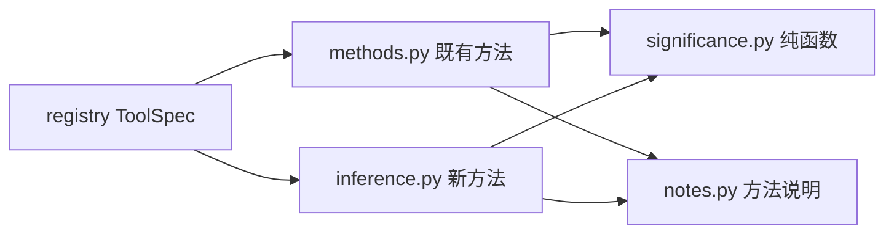

## 产品概述

依据《医学统计学》（第8版，李康、贺佳）第六至十章，把 MedSta 的推断统计层从「已实现若干方法」提升到「与教材判定口径一致」。上一轮（spec 023）只覆盖了第二、三、十一章，本轮补上参数估计、t 检验、方差分析、χ² 检验与非参数秩和检验，并用 1009 例真实基线数据验证。

## 核心功能

- **补齐缺失方法**：单样本检验（t / Wilcoxon 符号秩）、随机区组设计方差分析、配对四格表 McNemar、Kendall τ。
- **修正判定口径**：配对 t 检验不再做方差齐性检验（教材 §7 注意事项 2）；两独立样本的方差齐性改用教材的 F 检验并以 α=0.10 判定；四格表按「样本量 + 最小期望频数」三档自动选择专用公式、校正公式或 Fisher 精确检验。
- **对齐两两比较**：ANOVA 事后比较默认改为 SNK-q（studentized range），保留 Holm/Bonferroni；Kruskal-Wallis 事后增加 Dunn 检验 + Bonferroni，并标注教材未给公式。
- **多个样本率两两比较**：R×C 表整体显著后，按 χ² 分割法加 Bonferroni 调整检验水准输出两两结果。
- **区间估计补齐**：单样本与配对给出均数（差值）的 t 置信区间；分组率给出率及其置信区间，呼应教材「报告假设检验结论的同时应报告区间估计」。
- **真实数据验证**：从 1009 例基线表派生固定子集作为测试夹具，覆盖多分类、0/1 症状、偏态评分与缺失；全量数据另做一次手动冒烟。

## 视觉效果

不新增页面。新方法沿用既有审阅卡与工作区表格：修正后的两两比较表增加「跨度组数 a / q 值 / 校正后判定」列；配对四格表以 a/b/c/d 四格表加一致性说明呈现；单样本检验在结果里显示已知总体均数、差值均值与置信区间。所有新字段为增量，旧报告仍可渲染。

## 技术栈

沿用现有栈，无新依赖：Python 3.10+ / numpy / pandas / scipy（`t`、`f`、`chi2`、`studentized_range`、`norm`、`kendalltau`、`wilcoxon`）/ statsmodels / pydantic v2 / pytest。前端无需改动（审阅卡与表格为通用渲染），仅需在 `types.ts` 保持不变的前提下确认新列可显示。

## 实现策略

### 1. 新增 `stats/inference.py`，承载三个新方法

单样本检验、随机区组方差分析、配对四格表都不依赖既有 `group_compare` 的分组结构，独立成模块可避免 `methods.py` 继续膨胀（当前已 780 行）。

| 工具名 | 参数 | 输出要点 |
| --- | --- | --- |
| `one_sample_test` | `mu0`（number，必填）、`test`（auto/t/wilcoxon）、`sides`（two/greater/less） | `t`/`df`/`p_value`、`mean`/`sd`/`n`、`ci95`（t 临界值）、策略链（Shapiro → 参数/非参数） |
| `randomized_block_anova` | `group_column`（处理）、`block_column`（区组） | `ss_treatment`/`ss_block`/`ss_error`、`df` 三项、`ms_error`、`f_treatment`/`p_treatment`、`f_block`/`p_block` |
| `mcnemar_test` | `row_column`（方法 A）、`col_column`（方法 B） | 四格 `a/b/c/d`、`chi2`、`corrected`（b+c 是否小于 40）、`p_value`、一致性率 |


`randomized_block_anova` 不传 `chart_type` 之外的图；若需要，复用 `boxplot`（按处理分组）。`mcnemar_test` 交付为表格，`charts=()`。

### 2. 方差齐性口径改为教材的 F 检验

新增 `_f_variance_step(groups, alpha=0.10)`：`F = S²大 / S²小`，自由度 `n1−1`/`n2−1`，双侧 p 用 `2 * min(cdf, 1−cdf)` 与 `alpha=0.10` 比较。两独立样本的 `group_compare` 改为调用它；配对分支**跳过方差齐性检验**，策略链写明「配对设计不要求两组方差齐性（教材 §7 注意事项 2）」。

`levene_test` 工具保留（教材 §8-5 认可 Levene 用于非正态资料），但其判定 α 从 0.05 调整为 0.10，`method_note` 注明「两独立样本按教材用 F 检验；多组或非正态资料用 Levene」。

多组 ANOVA 的前置仍用 Levene（稳健），`method_note` 说明教材推荐 Bartlett（正态资料）或 Levene（非正态），本项目统一用 Levene 并在策略链注明。

### 3. ANOVA 事后比较改 SNK-q

在 `significance.py` 新增纯函数：

```python
def snk_q_pvalue(mean_a, mean_b, n_a, n_b, ms_error, df_error, span) -> tuple[float, float]
def dunn_pvalue(rank_sum_a, n_a, rank_sum_b, n_b, total_n, ties_correction) -> tuple[float, float]
def bonferroni_alpha(alpha: float, comparisons: int) -> float
```

- `q = |mean_a − mean_b| / sqrt(ms_error / 2 × (1/n_a + 1/n_b))`
- `p = studentized_range.sf(q, span, df_error)`，`span` 为两组在均值排序中的跨度组数
- 教材的逐步规则：先比较跨度最大的一对，若不显著则组内更小跨度的比较不再判定。实现保留全部原始 p 值供参考，但 `significant` 字段按逐步规则给出，并加 `step_down: true` 标记
- `correction` 参数扩展为 `snk / holm / bonferroni`，默认 `snk`；`holm`/`bonferroni` 沿用现有 `p_adjust`
- Kruskal-Wallis 路径改用 Dunn 检验 + Bonferroni：`z = (R̄a − R̄b) / sqrt(N(N+1)/12 × (1/na + 1/nb) × ties)`，`p` 双侧正态近似后乘比较次数

输出表列改为 `group_a/group_b/mean_diff/q_value/span/p_value/adjusted_p/significance`，保留 `statistic` 键以兼容既有断言（写入 q 或 U）。

### 4. 四格表三档判定与配对 McNemar

`chi_square` 把 `correction` 从 boolean 改为 choice（auto/yes/no，默认 auto），自动档按教材：

| 条件 | 方法 |
| --- | --- |
| n ≥ 40 且所有期望频数 ≥ 5 | 专用公式（不做连续性校正） |
| n ≥ 40 且最小期望频数在 1 到 5 之间 | 校正公式 |
| n 小于 40 或最小期望频数小于 1 | Fisher 精确检验 |


R×C 表保持原有「期望频数小于 5 的格子不超过 20% 且最小期望频数不小于 1」判定。`strategy.steps` 记录实际走了哪一档与依据数值。

配对四格表单独成工具，避免与独立样本 χ² 混用（教材 §9-2 明确禁止转换）。

### 5. 多个样本率两两比较

`chi_square` 在 R×C、列数为 2（多个样本率）且整体显著时输出 `pairwise`：

- 两两分割成 2×2 表，逐对做 χ²（按三档规则可能退化为 Fisher）
- 检验水准 `alpha_prime = alpha / C(k,2)`，落在 `adjusted_p` 与 `significant`
- 若用户只想「各试验组 vs 同一对照」，通过参数 `comparison`（all_pairs/vs_control，默认 all_pairs）切换，对应 α′ 为 `alpha/(k−1)`
- 输出 `multiplicity_warning`，说明 χ² 分割法较保守、组数不宜过多

### 6. 率的区间估计

在 `chi_square` 的 `group_rates` 中给每行「率 + 置信区间」：n 较大时用 Wald 正态近似，n 较小时用 Wilson 区间，并在 `method_note` 注明选择依据。单样本率的 CI 同理放进 `one_sample_test` 与描述工具不作改动（避免范围蔓延）。

### 7. Kendall τ

`correlation` 的 `method` 增加 `kendall`，用 `scipy.stats.kendalltau`（τ-b，自动处理 ties）。强度分档沿用 023 的 `_strength_label`（τ 值域同为 −1 到 1）。工具目录写明：Pearson 要求双变量正态；Spearman 用于单调关系或有序数据；Kendall 用于有序数据且样本量较小、ties 较多时更稳健。

### 8. 测试夹具

- 教材例题内联进 `tests/test_textbook_ch6_10.py`：例 7-1（t=1.77）、例 7-2（t=3.738）、例 7-4（F=5.402）、例 7-5（t′=7.018，ν′=14.687）、例 8-3（q=5.04/3.27/1.77）、例 9-4（χ²=0.364）、例 9-5（χ²=22.809）、例 9-7（分割法两两）、例 10-5（Hc=12.27）。
- 从 `docs/1.基线数据（1009例）.xlsx` 的 Sheet1 抽固定行（覆盖全部 22 列、保留缺失与多分类），落到 `backend/tests/fixtures/baseline_sample.csv`；派生脚本放 `scripts/derive_baseline_fixture.py`，只在需要时手动运行，CI 直接读 csv。
- 全量数据冒烟：`scripts/smoke_baseline.py` 走「上传 → 画像 → 统计描述 → 多组比较 → 卡方」的本地链路，输出耗时与关键结果，不入 CI。

### 9. 契约同步

新增三个方法必须同时更新：`MethodType` 字面量（由 `test_method_contract.py` 守护）、`_TASK_META`/`_SLOT_META`、`METHOD_NOTES`、`agents/interpretation.py::_SIMPLE_KEYS`。`anova` 的 `pairwise` 表列变化会波及 `test_stats_methods.py` 与导出，需同步。

## 实施注意

- **数值口径**：F 检验的 p 值用双侧（`2 * min(cdf, 1 - cdf)`）；SNK 的 `span` 必须按均值排序后的位次差加 1；Dunn 的 ties 校正用 `1 − Σ(t³−t)/(N³−N)`。
- **兼容性**：`anova.pairwise` 原键 `statistic` 保留（写 q 值或 U 值），新增 `q_value`；`chi_square.correction` 从 boolean 改 choice 会在旧计划里被当作 `true/false` 传入，`normalize_params` 需把布尔映射为 `yes/no`。
- **失败降级**：SNK 需要 `ms_error` 与 `df_error`；若 ANOVA 退化为 Kruskal，不进入 SNK 分支，避免用错误差项。
- **性能**：1009 行数据的分组统计与两两比较均为 O(k²)，k 通常小于 10，无瓶颈；Dunn 与 SNK 均无迭代。
- **测试隔离**：夹具 csv 走 `pathlib` 相对路径，不依赖 `docs/` 与 `.env`。
- **文档**：`docs/statistics-methods.md` 增加第六至十章对照表；`design-notes.md` 记录「教材口径 vs 软件默认」的取舍（F 检验 vs Levene、SNK vs Holm、χ² 三档）；`timeline.md`、`TO_DO.md`、`CODEBUDDY.md` 同步。

## 架构与目录



职责边界不变：判定、计算、校正全在宿主；模型只从工具目录选方法。

```
backend/src/medsta/stats/
├── inference.py     # [NEW] one_sample_test / randomized_block_anova / mcnemar_test
├── significance.py  # [MODIFY] snk_q_pvalue / dunn_pvalue / bonferroni_alpha
├── methods.py       # [MODIFY] group_compare（跳过配对 Levene、sides）、anova（SNK/Dunn）、
│                    #          chi_square（三档、pairwise、rates）、correlation（kendall）
├── registry.py      # [MODIFY] 注册 3 个新工具；correction 改 choice；correlation 增 kendall
└── notes.py         # [MODIFY] 新增/更新方法说明
backend/src/medsta/agents/
├── discussion.py    # [MODIFY] MethodType 增 3 个名称
└── interpretation.py# [MODIFY] _SIMPLE_KEYS 增新方法键
backend/tests/
├── test_textbook_ch6_10.py  # [NEW] 教材例题回归
├── test_inference.py        # [NEW] 单样本/区组/McNemar 边界
├── fixtures/baseline_sample.csv # [NEW] 真实数据固定子集
└── test_stats_methods.py    # [MODIFY] pairwise 列与判定同步
scripts/
├── derive_baseline_fixture.py  # [NEW] 从 xlsx 派生子集
└── smoke_baseline.py           # [NEW] 全量数据冒烟
```

## 关键接口

```python
def one_sample_test(df, step, params) -> dict
def randomized_block_anova(df, step, params) -> dict
def mcnemar_test(df, step, params) -> dict

def snk_q_pvalue(
    mean_a: float, mean_b: float, n_a: int, n_b: int,
    ms_error: float, df_error: int, span: int,
) -> tuple[float, float]

def dunn_pvalue(
    rank_mean_a: float, rank_mean_b: float, n_a: int, n_b: int,
    total_n: int, ties_correction: float,
) -> tuple[float, float]
```

## Agent Extensions

### Skill

- **tdd**
- Purpose: 项目强制 spec 驱动 + TDD。按「一条行为 → 一个测试先 RED → 最小实现 GREEN」推进，禁止先写全部测试或先写实现；教材例题夹具先行落地，作为外部数值基准。
- Expected outcome: 每条行为都有 RED→GREEN 记录；教材例题（7-1/7-2/7-4/7-5/8-3/9-4/9-5/9-7/10-5）逐条复现；新增用例不拉低 83% 覆盖率门槛。