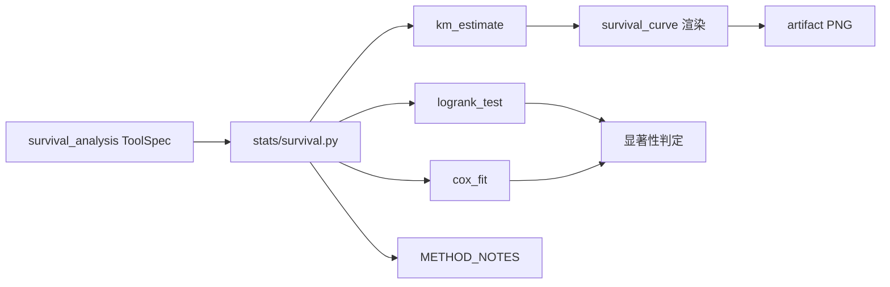

## 产品概述

按《医学统计学》第8版第十四章实现生存分析族，让项目从「只有横断面分析」扩展到「时间-事件结局」：能够估计生存曲线、比较组间生存率、做多因素 Cox 回归，并把删失数据纳入解释体系。

## 核心功能

- **Kaplan-Meier 生存曲线**：逐时间点给出期初人数、事件数、删失数、生存率、Greenwood 标准误与 95% 置信区间；给出中位生存期（未达到时明确说明而非返回 0）；给出风险人数表。
- **组间生存率比较**：log-rank 检验（多组）与 Breslow 检验，输出 χ²、自由度、P 值，并说明两种检验的差异（前者对晚期差异敏感，后者对早期差异敏感）。
- **Cox 比例风险回归**：输出每个协变量的回归系数、标准误、风险比 HR 及 HR 的 95% 置信区间、Wald P 值；整体给出似然比检验与 Score 检验；说明 HR 的方向含义（危险因素/保护因素）。
- **RMST（限制性平均生存时间）**：按 τ 截断的组间平均生存时间差，附 Greenwood 方差与置信区间；教材未给公式，明确标注外部来源。
- **PH 假设提示**：基于 Schoenfeld 残差给出比例风险假定的检验结果，违反时提示改用分层 Cox 或时依协变量，并标注该方法不在教材正文内。
- **生存曲线图**：阶梯状生存曲线，删失点以标记显示，多组同图并带图例。

## 视觉与效果

沿用现有审阅卡与工作区：KM 结果以「逐时间点表格 + 生存曲线图」交付；log-rank 与 Cox 以统计表交付（协变量、β、SE、HR、95%CI、P）；中位生存期在汇总行高亮，未达到时显示「未达到（随访期内生存率未降至 50%）」而非空白。新增图表类型在能力抽屉中自动披露。

## 边界

- 做：右删失、左截断不处理；KM、log-rank、Breslow、Cox、RMST、Schoenfeld 残差检验。
- 不做：竞争风险与 Fine–Gray、时依协变量、分层 Cox（strata）、参数生存模型（Weibull/exponential）、寿命表法、区间删失、左截断。

## 技术栈

完全沿用现有栈，**不新增依赖**：

- Python 3.10+ / numpy / pandas / scipy 1.18 / **statsmodels 0.15**（`duration.hazard_regression.PHReg`）
- matplotlib（Agg 后端）沿用现有 `plotting.py`
- pytest（TDD）；pydantic v2 契约
- 前端无需改动（表格与图表均为通用渲染）

已实测确认：`PHReg(t, X, status=e, ties='efron').fit()` 提供 `params`、`bse`、`pvalues`、`schoenfeld_residuals()`、`baseline_cumulative_hazard()`；
但 **`llr` / `llr_pvalue` 为 None**，整体似然比检验必须手动构造零模型 `2*(llr_full − llr_null)`。

## 实现策略

### 1. 新建 `stats/survival.py`，不并入 `inference.py`

`inference.py` 已承载单样本/区组/析因/重复测量/McNemar/样本量六类方法、约 700 行；生存分析的 KM 迭代、Greenwood 累加、log-rank 方差、Cox 包装都是自成一套的算法，继续塞入会让该文件失去可读性。新建模块与 023 拆出 `descriptive.py`、025 拆出 `notes.py` 的做法一致。

### 2. 单一工具 `survival_analysis`，`method` 参数分派

理由：KM、log-rank、Cox 共用同一份 `time_col` / `event_col`，拆成三个工具会导致同一份数据被重复校验三次，且模型容易只选 KM 而遗漏组间比较。

| 参数 | 类型 | 说明 |
| --- | --- | --- |
| `time_col` | column（必填） | 随访时间，必须非负有限 |
| `event_col` | column（必填） | 事件指示，1=事件、0=删失（教材表 14-4 的编码），仅接受 0/1 |
| `group_col` | column（可选） | 分组变量，用于分组 KM 与 log-rank |
| `covariates` | column_list（可选） | Cox 协变量 |
| `method` | choice：auto/km/logrank/cox | auto：有 covariates→cox；有 group_col→logrank；否则 km |
| `test` | choice：logrank/breslow | 默认 logrank |
| `tau` | number（可选） | RMST 的截断时间，默认各组最大随访时间的最小值 |


### 3. KM 实现要点（严格对齐教材 §14-2）

- 时间升序；**同一时间点完全数据排在删失数据之前**（教材 6179 明确规定，实现时需先按 `(time, event_desc)` 排序）。
- `n_i = n_{i-1} − d_{i-1} − c_{i-1}`；`q_i = d_i/n_i`；`p_i = 1 − q_i`；`S(t_i) = S(t_{i-1})·p_i`。
- Greenwood：`SE = S·√(Σ d_j/(n_j(n_j−d_j)))`，累加项在 `n_j == d_j` 时跳过（避免除零），此时 SE 记为 0 或 `None`。
- 置信区间 `S ± z·SE` **截断到 [0,1]**，并在结果中加 `ci_truncated=true` 提示（教材 6213 明确末端可能越界）。
- 中位生存期：找首个 `S(t) ≤ 0.5` 的时间点，与前一非删失时间点线性插值；若全程 `S > 0.5`，返回 `None` 并附 `median_survival_note="随访期内生存率未降至 50%"`。

### 4. log-rank 与 Breslow

按教材 14-8/14-9 逐时间点累加：每个事件时间点计算各组的 `n_ki`、`d_ki`，理论数 `T_ki = n_ki·d_i/n_i`，方差 `V_ki = (n_ki/n_i)(1−n_ki/n_i)((n_i−d_i)/(n_i−1))·d_i`。
多组时用 `Σ_k (O_k−E_k)²/V_k` 的 k−1 维形式，实现上按 g−1 个自由度构造协方差矩阵求二次型，避免只对第一组求和导致 χ² 偏大。
Breslow 与 log-rank 的唯一差别是权重：log-rank 权重为 1，Breslow 权重为 `n_i`（广义 Wilcoxon）。

### 5. Cox：包装 + 补齐三项检验

`PHReg` 给 Wald；LR 需自建零模型；Score 检验用 `PHReg(...).fit().score` 或 `2*(llf − llf_null)` 的近似不可靠，实现时优先取 `PHReg` 的 `score` 属性，若不可用则只输出 LR 与 Wald 并在字段中说明 Score 不可用，**不伪造数值**。

### 6. PH 假设检验（教材未给，标注外部来源）

用 `schoenfeld_residuals()` 按时间排序后计算每个协变量残差与时间的 Spearman 相关，给出 `rho` 与 `p`；任一 `p < 0.05` 时在 `strategy.steps` 与 `method_note` 提示「比例风险假定可能不满足，考虑分层 Cox 或时依协变量」。该方法的依据标注为「Schoenfeld 1982，教材第十四章未展开」。

### 7. RMST（教材未给，标注外部来源）

τ 默认取各组最大随访时间的最小值（保证两组可比）；`RMST = ∫₀^τ S(t)dt` 用阶梯曲线梯形积分；方差用 Greenwood 型近似；输出 `rmst_diff` 与 95%CI。若某组在 τ 前已无风险人数，提示「τ 超过该组最大随访时间」。

### 8. 新增图表 `survival_curve`

在 `plotting.py` 的 if/elif 链中新增分支：`plt.step(..., where='post')` 画阶梯；删失点用 `marker='+'` 画在曲线高度；多组循环并加 `label`；`CHART_TYPES` 与 `CHART_LABELS` 同步；`default_chart_for` 对 `survival_analysis` 返回 `survival_curve`。

### 9. 能力披露修正

`routes_capabilities.py` 的 `_PLANNED` 中 `survival_analysis` 条目描述错误（写「需引入 lifelines」），实现后**从 `_PLANNED` 移除**，由 `tool_catalog()` 自动披露；Fine–Gray 单独保留一条 planned 说明「竞争风险需专门模型，当前不支持」。

## Implementation Notes

- **性能**：KM 与 log-rank 均为 O(n log n)（排序主导）；Cox 为 statsmodels 迭代，n=1009 时约百毫秒级，无瓶颈。
- **数值稳定性**：`n_j == d_j` 时 Greenwood 累加项除零，必须显式跳过；`S(t) = 0` 时 `log` 变换不可用，CI 直接截断。
- **失败降级**：事件编码非 0/1、全删失（事件数=0）、时间为负、Cox 协变量为常数，均抛 `ValueError`，经 `execute_step` 转为 `EXECUTION_FAILED` 并单步隔离。
- **契约同步**：`MethodType`、`_REGISTRY`、`_TASK_META`、`_SLOT_META`、`METHOD_NOTES`、`interpretation._SIMPLE_KEYS`、`CHART_TYPES`、`CHART_LABELS` 共 8 处，缺一处由 `test_method_contract.py` 或 `test_capabilities.py` 捕获。
- **测试隔离**：教材例 14-2 数据内联为常量，不读 `docs/`；不依赖 `.env`；Cox 用构造数据（教材例 14-4 表格被省略，无法完整复现）。
- **文档**：`statistics-methods.md` 新增第十四章口径与外部来源标注；`design-notes.md` 记录「删失不是缺失值」与「PH 假设未检验的风险」；`timeline.md` 按倒序四列格式追加；`TO_DO.md` 将 027 移入已完成、更新已知限制；`CODEBUDDY.md` 更新测试数与模块清单。

## 架构设计



职责边界不变：KM/log-rank/Cox 的计算、校验、判定全在宿主；模型只从工具目录选方法并解读结论。

## 目录结构

```
backend/src/medsta/stats/
├── survival.py                     # [NEW] 生存分析核心。km_estimate（排序规则、n_i/d_i/c_i、
│                                   #   S(t)、Greenwood SE、CI 截断、中位生存期插值）、
│                                   #   logrank_test（log-rank 与 Breslow 权重、多组二次型）、
│                                   #   cox_fit（PHReg 包装、HR 与 CI、LR/Wald/Score、Schoenfeld）、
│                                   #   rmst（梯形积分 + Greenwood 方差）、survival_analysis（handler，
│                                   #   参数分派、数据校验、表格与 method_note 组装）
├── registry.py                     # [MODIFY] 注册 survival_analysis ToolSpec；
│                                   #   CHART_TYPES 增 survival_curve；_TASK_META/_SLOT_META 补条目
├── notes.py                        # [MODIFY] 新增 survival_analysis 方法说明（第十四章口径 +
│                                   #   RMST/PH 假设的外部来源标注）
├── plotting.py                     # [MODIFY] CHART_LABELS 增生存曲线；render_chart 增 survival_curve
│                                   #   分支（plt.step + 删失标记 + 多组图例）；default_chart_for 映射
└── api/routes_capabilities.py      # [MODIFY] 从 _PLANNED 移除 survival_analysis（描述有误），
                                    #   新增 fine_gray 的 planned 说明

backend/src/medsta/agents/
├── discussion.py                   # [MODIFY] MethodType 增 survival_analysis
└── interpretation.py               # [MODIFY] _SIMPLE_KEYS 增生存分析结论键
                                    #   （median_survival/logrank_p/hr/lr_p/score_p）

backend/tests/
├── test_survival.py                # [NEW] KM 复现表 14-2 逐行、中位生存期达到与未达到、
│                                   #   排序规则（同时间删失在后）、CI 截断、Greenwood 除零
├── test_survival_cox.py            # [NEW] Cox 与 PHReg 一致、HR/CI、LR 与 Wald、Score 可用性、
│                                   #   Schoenfeld 输出、RMST 数值与 τ 截断
├── test_survival_edges.py          # [NEW] 事件编码非 0/1、全删失、负时间、单组、组内无事件
├── test_capabilities.py            # [MODIFY] survival_analysis 进入 tools 而非 planned
└── test_method_contract.py         # [AUTO] 枚举一致性自动守护
```

## 关键接口

```python
def km_estimate(
    time: np.ndarray, event: np.ndarray
) -> dict:  # points / median / median_reached / ci_truncated

def logrank_test(
    time: np.ndarray, event: np.ndarray, group: np.ndarray, *, weight: str = "logrank"
) -> dict:  # chi2 / df / p_value / observed / expected / method

def cox_fit(
    time: np.ndarray, event: np.ndarray, covariates: pd.DataFrame
) -> dict:  # coefficients / hr / ci / lr_test / wald_test / score_test / ph_check

def rmst(
    time: np.ndarray, event: np.ndarray, *, tau: float
) -> dict:  # rmst / se / ci / truncated
```

## 关键技术取舍

| 决策 | 选择 | 理由 |
| --- | --- | --- |
| 工具形态 | 单一工具 + method 分派 | 共用 time/event 列，避免三次重复校验与模型漏选 |
| 模块位置 | 新建 `survival.py` | `inference.py` 已 700 行，生存分析算法自成一套 |
| Cron 检验 | PHReg + 手建零模型 | statsmodels 的 `llr` 为 None，必须自己算 LR |
| 多组 log-rank | g−1 维二次型 | 只对第一组求和会让 χ² 偏大，各组方差需进协方差矩阵 |
| PH 假设 | Schoenfeld + Spearman | 教材未给，标注外部来源，不伪造检验 |
| RMST | τ 取各组最大随访最小值 | 保证两组在同一时间窗内可比 |
| Fine–Gray | 不做，保持 planned | 竞争风险需子分布模型，成本与出错风险都高 |


## Agent Extensions

### Skill

- **tdd**
- Purpose: 按项目强制的 spec 驱动 + TDD 推进，一条行为一个测试先确认 RED，再写最小实现转 GREEN。
- Expected outcome: `spec/027-survival-analysis.md` 的行为列表逐条勾选完成，每条都有 RED→GREEN 记录；教材表 14-2 的 15 个时间点作为外部数值基准先行落地；新增用例不拉低 83% 覆盖率门槛。