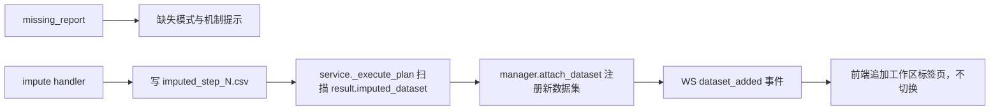

## 用户需求

在 MedSta 中补齐「缺失数据路径」：从目前只能报告缺失率，升级为能诊断缺失模式、给出处理路径建议，并真正产出插补后的数据集供后续分析使用。

## 确认的范围决策

1. **插补产出新数据集**：`missing_report` 增强为「缺失模式 + 机制提示 + 路径建议」；新增 `impute` 工具，产出「已插补」数据集写入工作区，用户切换后继续分析，并在结果与工作区标注「方差低估」与插补次数。
2. **scikit-learn 作为必需依赖**：直接写入 `backend/pyproject.toml` 的 `dependencies`，所有安装者都获得 MICE 能力，不做可选降级分支。
3. **敏感性分析做单变量 delta 扫描**：对插补值加/减 delta，输出均值与分布偏移表；不做结论翻转判定（tipping point 属后续）。

## 功能内容

- **缺失报告**：逐列缺失率、缺失模式（单变量/单调/任意）、完整行比例、分组缺失差异提示，以及「MCAR/MAR/MNAR 不能仅凭数据判定」的明确声明。
- **插补**：MICE（`IterativeImputer`，m 次插补取均值 + 插补间方差）、中位数、均值、LOCF 四种方法；后三者强制标记 `sensitivity_only`。
- **数据集产出**：插补结果写入 CSV，注册为会话内新数据集，命名为「原名（MICE 插补）」，工作区新增标签页并标注「已插补」。
- **delta 扫描**：给定 delta 时输出 -delta / 0 / +delta 三行的均值偏移表。

## 边界

- 不做完整多重插补与 Rubin 合并（本期产出的单份数据集**不是** MI）。
- 不做 MMRM、tipping point、MNAR 选择模型、纵向缺失。
- 不做 Little's MCAR 正式检验，机制只给提示不给判定。

## 视觉与交互

工作区新增一个标签页（「原表名（MICE 插补）」），画像表顶部显示「已插补」角标与缺失数归零说明；审阅卡中 `impute` 步骤展示「插补前后缺失数、方法、m、插补间方差」摘要表。不新增页面。

## 技术栈

沿用现有栈，新增一个运行时依赖：

- Python 3.10+ / numpy / pandas / scipy 1.18 / statsmodels 0.15
- **scikit-learn >= 1.3**（`IterativeImputer`，需 `from sklearn.experimental import enable_iterative_imputer`）
- pydantic v2 / pytest；前端 React 18 + TS，无需新依赖

当前环境实测**未安装 sklearn**（`ModuleNotFoundError`），需执行 `pip install -e ".[dev]"`（清华镜像）。

## 实现策略

### 1. 教材 0 覆盖，全部按外部标准

教材中 `缺失值 / 插补 / MCAR / MAR / MNAR / 多重插补` 均为 0 次，无专章。所有方法说明必须标注外部依据（Little & Rubin 2019、van Buuren 2018），不得声称「按教材」。这与 025 建立的规则一致。

### 2. 关键架构接入点：步骤如何产出数据集

`execute_step(df, step, artifact_dir, index)` 调用 `spec.handler(df, step, params)`，**artifact_dir 不传给 handler**。因此：

- 在 `execute_step` 中向 `params` 注入内部保留键 `_artifact_dir`（已有 `_forecast_values` 回写先例，属同类约定）。
- `impute` handler 写出 `imputed_step_<index>.csv` 到该目录，返回 `imputed_dataset` 元信息。
- `service._execute_plan` 在拿到 report 后扫描各步骤 `result.imputed_dataset`：读回 CSV → `manager.attach_dataset(...)` 注册新数据集 → 推送新事件 `dataset_added`。
- **不自动切换 active 数据集**，避免打断用户当前工作区。

### 3. 新事件而非复用 data_profile

现有 `data_profile` 在 `App.tsx` 中会 `setActiveWorkspaceId(datasetId)`，即自动切换工作区。复用会打断用户当前上下文。

新增 `{ type: "dataset_added", dataset_id, name, profile, imputed: true, source_dataset_id }`，前端只追加工作区标签页并提示「已生成插补数据集」，不切换。需同步 `spec/done/006-session-api.md` 的 WS 契约与前端 `types.ts`。

### 4. 单数据集插补必须诚实标注

`IterativeImputer` 跑 m 次（默认 20），取逐元素均值写入数据集，同时输出 `between_imputation_variance`（m 次插补间的逐元素方差均值）作为不确定性指示。结果字段、`method_note`、数据集名称三处同时声明「单数据集插补，非 Rubin 合并，标准误偏小」。

m < 20 时不拒绝但强制 `warnings` 提示；m 上限 50 防性能问题。

### 5. 机制提示只给提示

不用 Little's MCAR 检验（实现与解释成本高）。改用：

- 缺失模式分类（每列缺失集合是否为其余列的子集 → 单调/非单调）
- 分组缺失差异：对每个分组列做「缺失 vs 非缺失 × 组别」卡方，p<0.05 时提示「缺失可能与分组有关」
- 完整行比例与单列缺失率阈值提示

输出 `mechanism_hint` 字段，附「不能据此断定 MCAR/MAR/MNAR」。

### 6. delta 扫描

给定 `delta` 时，对插补值整体加 ±delta（仅限连续列），输出三行：`-delta / 0 / +delta` 的插补列均值与标准差。线性偏移可直接核对，不做下游重跑。

## 数据流



## 目录结构

```
backend/
├── pyproject.toml                       # [MODIFY] dependencies 增 "scikit-learn>=1.3"
├── src/medsta/stats/
│   ├── impute.py                        # [NEW] missing_pattern / mechanism_hint /
│   │                                    #   impute_mice（m 次 + 插补间方差）/ impute_simple（median/mean/locf）/
│   │                                    #   delta_scan / impute（handler）
│   ├── methods.py                       # [MODIFY] missing_report 增强：缺失模式、完整行比例、
│   │                                    #   分组缺失差异卡方、mechanism_hint、阈值 warnings
│   ├── registry.py                      # [MODIFY] 注册 impute ToolSpec（charts=()，min_rows=2）；
│   │                                    #   execute_step 注入 params["_artifact_dir"]
│   ├── notes.py                         # [MODIFY] 新增 impute 说明（外部依据 + 单数据集≠MI）
│   └── descriptive.py                   # [不改] classify_distribution 可复用于插补前后分布对比
├── src/medsta/session/
│   ├── manager.py                       # [不改] attach_dataset 已支持
│   └── service.py                       # [MODIFY] _execute_plan 扫描 imputed_dataset → attach_dataset
│                                        #   → 推 dataset_added；记录数据集来源
├── src/medsta/agents/
│   ├── discussion.py                    # [MODIFY] MethodType 增 impute
│   └── interpretation.py                # [MODIFY] _SIMPLE_KEYS 增 impute 结论键
└── src/medsta/api/routes_capabilities.py # [MODIFY] planned 的 multiple_imputation 描述改为
                                          #   「完整多重插补（Rubin 合并）未实现，当前为单数据集插补」

backend/tests/
├── test_impute.py                       # [NEW] MICE 恢复度、插补间方差、m 阈值、LOCF 标记、
│                                        #   delta 扫描、插补后无缺失与形状一致、>50% 缺失拒绝
├── test_missing_report.py               # [NEW] 缺失模式分类、分组差异提示、完整行比例、阈值警告
├── test_imputed_dataset_flow.py         # [NEW] service 层：执行含 impute 的计划后 datasets 增一项、
│                                        #   active 不变、dataset_added 事件结构
├── test_stats_methods.py                # [MODIFY] missing_report 既有断言同步
└── test_capabilities.py                 # [MODIFY] impute 进入 tools

frontend/src/
├── types.ts                             # [MODIFY] WsEvent 增 dataset_added；TableProfile 增 imputed?
├── App.tsx                              # [MODIFY] case "dataset_added"：追加工作区，不切换 active
└── workspace/WorkspacePanel.tsx         # [MODIFY] 画像表顶部「已插补」角标与来源说明
```

## 关键接口

```python
class ImputeConfig(BaseModel):
    columns: list[str]
    method: Literal["mice", "median", "mean", "locf"]
    m: int = 20
    max_iter: int = 10
    delta: float | None = None
    random_state: int = 20261023

def missing_pattern(df: pd.DataFrame, columns: list[str]) -> dict: ...
def mechanism_hint(df: pd.DataFrame, columns: list[str], group_by: str | None) -> dict: ...
def impute_mice(frame: pd.DataFrame, columns: list[str], *, m: int, max_iter: int,
                random_state: int) -> tuple[pd.DataFrame, float]: ...   # 返回 (插补后数据, 插补间方差均值)
def impute_simple(frame: pd.DataFrame, columns: list[str], method: str) -> pd.DataFrame: ...
def delta_scan(frame: pd.DataFrame, columns: list[str], imputed: pd.DataFrame,
               delta: float) -> dict: ...
def impute(df: pd.DataFrame, step: Any, params: dict) -> dict: ...
```

`impute` handler 输出字段：

| 字段 | 说明 |
| --- | --- |
| `imputed_dataset` | `path`/`name`/`rows`/`columns`/`missing_before`/`missing_after`/`method`/`m` |
| `between_imputation_variance` | m 次插补间逐元素方差均值；无缺失时为 0 |
| `sensitivity_only` | median/mean/locf 为 true，且不产出 `imputed_dataset` |
| `delta_scan` | `rows[{delta, mean, sd}]`，未传 delta 时为 `None` |
| `warnings` | m<20、单列缺失>50%、完整行<10% 等 |
| `method_note` | 外部依据 + 单数据集≠MI |


## 行为列表（TDD 队列，18 条）

- B1: `missing_report` 输出逐列缺失模式（单变量/单调/非单调）与完整行比例
- B2: 存在分组列时输出「缺失 vs 非缺失 × 组别」卡方与 p，p<0.05 时给机制提示
- B3: 单列缺失 >50% 时给「建议删除该列」警告；完整行 <10% 时给样本量警告
- B4: `missing_report` 明确声明「不能据此断定 MCAR/MAR/MNAR」
- B5: `impute` 默认 MICE，m=20，插补后指定列无缺失且行列数不变
- B6: 已知结构 `y=2x+ε` 置空 20% 后插补，`y` 与真实值相关 >0.8
- B7: 完全无缺失时 `between_imputation_variance` 为 0；有缺失时 >0
- B8: m<20 时输出 warning 但仍执行；m>50 时截断到 50 并提示
- B9: 单列缺失 >50% 时拒绝该列并给出可读错误
- B10: `method=median/mean/locf` 时 `sensitivity_only=true` 且不产出 `imputed_dataset`
- B11: 传 `delta` 时输出三行扫描表，均值随 delta 线性偏移
- B12: 插补数据集写出 CSV 到 `_artifact_dir`，路径与文件名稳定
- B13: `execute_step` 向 params 注入 `_artifact_dir`，不影响既有方法
- B14: service 执行含 `impute` 的计划后 `session.datasets` 增一项，`active_dataset_id` 不变
- B15: 推送 `dataset_added` 事件，含 dataset_id/name/profile/imputed/source_dataset_id
- B16: 前端收到 `dataset_added` 追加工作区标签页且不切换 active
- B17: 工作区画像表显示「已插补」角标
- B18: `/capabilities` 中 `impute` 进入 tools，`planned` 的 multiple_imputation 说明改为「完整 MI 未实现」

## 测试基准

- MICE 恢复度、插补间方差、形状与类型不变、delta 线性偏移均为确定性断言（固定 `random_state=20261023`）。
- service 层用 fake agent + 显式含 `impute` 的 PLAN，断言 `session.datasets` 与事件。
- 回归：现有 316 项后端、44 项前端、E2E 2 项不回归，覆盖率 ≥83%。

## 实施注意

- `IterativeImputer` 需显式 `from sklearn.experimental import enable_iterative_imputer`，否则 sklearn 1.3+ 仍报导入错误。
- `_artifact_dir` 是内部保留键，需在 spec 中声明，避免模型把它当业务参数。
- 插补数据集不自动成为 active；若用户不切换，后续分析仍用原始数据——这是刻意选择，需在审阅卡摘要中提示「已生成插补数据集，可在工作区切换」。
- `between_imputation_variance` 的量纲随列变化，只能作相对指示，不能当标准误使用。
- 前端 `TableProfile.imputed` 为可选字段，旧数据不受影响；`WorkspacePanel` 需对缺省值容错。

## Agent Extensions

### Skill

- **tdd**
- Purpose: 项目强制 spec 驱动 + TDD，按「一条行为 → 一个测试先 RED → 最小实现 GREEN」推进。
- Expected outcome: `spec/028-missing-data-path.md` 的 18 条行为逐条勾选，每条有 RED→GREEN 记录；MICE 恢复度与插补间方差作为确定性基准先行落地；新增用例不拉低 83% 覆盖率门槛。