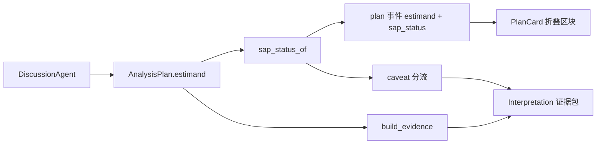

## 产品概述

为分析方案补上「估计目标（Estimand）」这一层：让用户在动手执行之前，先看清这份分析到底在回答什么问题——目标人群是谁、结局变量是什么、比较哪两组处理、伴发事件怎么算、最终用什么指标汇总。方案卡上以折叠区块展示，未声明时明确标为探索性分析。

## 核心功能

- **五要素结构化**：按 ICH E9(R1) 定义目标人群、结局变量、处理与对照、伴发事件及处理策略（五种策略可选）、群体水平汇总指标。
- **状态判定由宿主完成**：四个文本要素（人群/变量/处理/汇总）全部非空即标为「已声明估计目标」；缺任一项或整体未填则标为「探索性」。判定逻辑归宿主，模型与前端都无法改写。
- **模型可选生成，允许留空**：讨论时模型顺带产出五要素，但提示词明确要求「无法确定时留空，不要编造人群与干预」。留空是安全默认，不会阻断方案生成。
- **方案卡折叠展示**：方案卡内新增可展开区块，逐项列出五要素与状态徽章；探索性时额外列出缺少哪几项。
- **解读话术分流**：已声明时用「已声明估计目标但未经 SAP 冻结」；未声明时沿用现有探索性文案。两者都保留「不宜作为确证性推断」。

## 视觉与交互

方案卡在「方案说明」与「步骤列表」之间插入一行状态徽章（灰蓝=已声明、橙=探索性），下方是可折叠的「估计目标」区块：五个字段按「人群 / 变量 / 处理 / 伴发事件 / 汇总指标」纵向排列，伴发事件以「事件 + 策略」成对呈现；探索性状态下区块默认展开并高亮缺失项。未声明且模型未产出时，区块显示一行提示而非空白。

## 边界

- 不新增 WebSocket 事件：五要素随现有方案事件下发，修改走现有「补充 / 修正」通道让模型重新生成。
- 不做 SAP 摘要导出、不做事前注册、不做盲态与样本量论证。
- 不把「五要素齐全」表述为确证性分析或 pre-specified：系统无法验证事前冻结，措辞统一为「已声明估计目标」。
- 不校验五要素文本里提到的变量是否真实存在于数据列（语义校验易误伤，留待后续）。

## Tech Stack Selection

完全沿用现有栈，不新增依赖：

- 后端：Python 3.10+ / pydantic v2（`EstimandSpec` 契约）/ FastAPI
- 前端：React 18 + TypeScript + Tailwind 3 + Vitest/RTL
- 测试：pytest（后端）、vitest（前端）、Playwright（E2E 回归）

## Implementation Approach

### 五个关键决策

**1. `EstimandSpec` 全字段给默认空值，完整性由宿主判定。**

模型可能只填一部分，pydantic 不能因此拒绝整份方案——否则一次漏填就会让用户拿不到方案。字段全部 `default=""` / `default_factory=list`，`sap_status_of(plan)` 作为纯函数判定：

```
四文本（population/variable/treatment/summary_measure）全非空 → estimand_declared
否则（含 estimand is None）→ exploratory
```

`intercurrent_events` 允许为空列表（表示无伴发事件），不参与完整性判定——把「没有伴发事件」误判为「未声明」会让大量真实场景被标成探索性。

**2. `sap_status` 是计算值，不是存储字段。**

不作为 `AnalysisPlan` 的字段，避免模型输出或前端伪造。在 `service.py` 组装 `plan` 事件时显式写入 `sap_status`，前端只消费、不推导。这样「状态只有一个来源」这条约束在契约层就成立。

**3. 措辞红线：不出现 `pre-specified` / `确证性` 描述本项目流程。**

即使五要素齐全，系统也只能说「声明过估计目标」。要做成硬门：新增一条测试扫描后端文案常量与前端展示字符串，禁止这两个词用于描述本系统产出。这是本 spec 唯一容易被后续改动破坏的约束，必须用测试锁住。

**4. caveat 分流，而不是叠加。**

`EXPLORATORY_CAVEAT` 保留给未声明场景；新增 `ESTIMAND_DECLARED_CAVEAT`（「已声明估计目标，但未经 SAP 冻结与样本量论证」）。`_sanitize` 按 `sap_status` 二选一，绝不两条同时出现——两条并列会互相稀释，用户读不出区别。

**5. 不新增 WS 事件，走现有补充通道。**

用户想改五要素，通过方案卡的「补充」选项把意见喂回讨论，模型重新生成整份方案（含新的 estimand）。这避免了 `estimand_update` 的合并语义（部分更新 vs 整体替换）与并发冲突，代价是每次修改都重出一份方案——与该卡片现有的交互一致。

### 性能与可靠性

- 五要素是纯文本，`plan` 事件体积增加约 200–400 字节，相对现有 1–2KB 的方案载荷可忽略。
- 判定为 O(1)，无额外计算。
- 模型输出缺 `estimand` 时 pydantic 用默认值补齐，不触发重试；只有 `strategy` 枚举非法才会被拒绝（此时重试一次，仍失败则整份方案拒绝，与现有硬错误路径一致）。

### 避免技术债

- 复用 `_validate_plan` 的硬/软错误分层：estimand 不参与硬校验（B8 明确不做语义校验），只做枚举与长度约束。
- 复用 `build_evidence` 的证据白名单模式，estimand 整体作为一个字段注入，不拆散。
- 提示词增补放在 `_BASE_INSTRUCT` 末尾，不改动现有 7 条指令的顺序与编号，降低回归风险。

## Architecture Design



职责边界：模型只提供四段语义文本与伴发事件列表；完整性判定、状态标注、caveat 选择全在宿主。

## Directory Structure

```
backend/src/medsta/
├── agents/
│   ├── discussion.py        # [MODIFY] (1) 新增 IntercurrentEvent / EstimandSpec 模型（strategy 用 Literal 五值）；
│   │                        #   (2) AnalysisPlan 增 estimand: EstimandSpec | None = None；
│   │                        #   (3) 新增 sap_status_of(plan) 纯函数与 SAP_STATUS_* 常量；
│   │                        #   (4) _BASE_INSTRUCT 末尾增补第 8 条指令：无法确定时留空、禁止编造人群与干预、
│   │                        #       伴发事件策略五选一、汇总指标须与所选方法一致；
│   │                        #   (5) _OUTPUT_FIELDS 增 estimand 字段描述（嵌套结构，四文本 + 事件数组）。
│   └── interpretation.py    # [MODIFY] (1) 新增 ESTIMAND_DECLARED_CAVEAT 常量；
│                            #   (2) _sanitize 按 plan.sap_status 二选一追加 caveat（替换现有无条件追加）；
│                            #   (3) build_evidence 增 estimand 与 sap_status 两个字段。
├── session/service.py       # [MODIFY] plan 事件 payload 增 estimand（model_dump 或 None）与 sap_status（纯函数计算）。
└── api/routes_capabilities.py  # [MODIFY] _PLANNED 增 sap_export 条目：
                                 #       标题「SAP 摘要导出与事前注册」，描述「当前仅在方案卡展示估计目标；
                                 #       SAP 文档导出、版本号与注册信息未实现」。

backend/tests/
├── test_estimand.py         # [NEW] 后端行为锁定（见 todolist 第 1、2 项）
├── test_interpretation.py   # [MODIFY] 增 caveat 分流用例（原「无条件追加探索性文案」断言改为按状态断言）
├── test_plan_guard.py       # [MODIFY] 增 estimand 缺省不阻断方案、strategy 非法被拒的用例
└── test_capabilities.py     # [MODIFY] planned 含 sap_export

frontend/src/
├── types.ts                 # [MODIFY] 新增 IntercurrentEvent / EstimandSpec 接口；
│                            #   ChatMessage 的 plan 分支增 estimand?: EstimandSpec | null 与 sap_status?: string。
├── chat/ChatPanel.tsx       # [MODIFY] 把 estimand 与 sap_status 透传给 PlanCard。
├── chat/PlanCard.tsx        # [MODIFY] Props 增 estimand/sapStatus；
│                            #   (1) 方案说明下方一行状态徽章；
│                            #   (2) 可折叠「估计目标」区块（五字段纵向 + 伴发事件成对）；
│                            #   (3) 探索性时默认展开并列出缺失项；
│                            #   (4) estimand 为 null 时渲染一行「模型未给出估计目标」。
└── chat/PlanCard.estimand.test.tsx  # [NEW] RTL：五要素渲染、缺失项提示、无 estimand 不渲染区块。
```

## Key Code Structures

```python
class IntercurrentEvent(BaseModel):
    event: str = ""
    strategy: Literal[
        "treatment-policy", "hypothetical", "composite",
        "while-on-treatment", "principal-stratum",
    ] = "treatment-policy"


class EstimandSpec(BaseModel):
    population: str = ""
    variable: str = ""
    treatment: str = ""
    intercurrent_events: list[IntercurrentEvent] = Field(default_factory=list)
    summary_measure: str = ""


def sap_status_of(plan: AnalysisPlan) -> str: ...
```

## Implementation Notes

- **两条生成路径都要覆盖**：`draft_plan` 与 `draft_plan_stream` 各自组装请求，estimand 走 pydantic 反序列化即可，但测试必须两条都断言，否则流式路径漏测是隐蔽回归。
- **`_sanitize` 时序**：caveat 分流需要拿到 `plan`，而当前 `interpret/answer` 都已有 plan 参数，无需改签名；但 `answer` 路径是否也分流需明确——统一分流，避免同一份交付的解读与答疑口径不一致。
- **文案扫描测试的范围**：扫描 `backend/src/medsta/agents/*.py` 与 `frontend/src/chat/PlanCard.tsx` 的字符串常量，排除注释；发现 `pre-specified` 或用于描述本系统流程的「确证性」即失败。
- **前端默认展开策略**：探索性默认展开（提示缺失），已声明默认折叠（信息完整，不占版面）。
- **兼容性**：`estimand` 为可选字段，旧 plan 事件（无该字段）前端按 `null` 处理，不报错。
- **回归面**：`test_interpretation.py` 现有「caveats 末尾必为 EXPLORATORY_CAVEAT」的断言会因分流而变化，需同步为「按 sap_status 断言对应文案」。

## Agent Extensions

### Skill

- **tdd**
- Purpose: 项目强制 spec 驱动 + TDD，按「一条行为 → 一个测试先 RED → 最小实现 GREEN」推进。
- Expected outcome: `spec/029-estimand-sap.md` 的 16 条行为逐条勾选，每条有 RED→GREEN 记录；`sap_status` 判定与 caveat 分流作为确定性基准先行落地；新增用例不拉低 83% 覆盖率门槛。