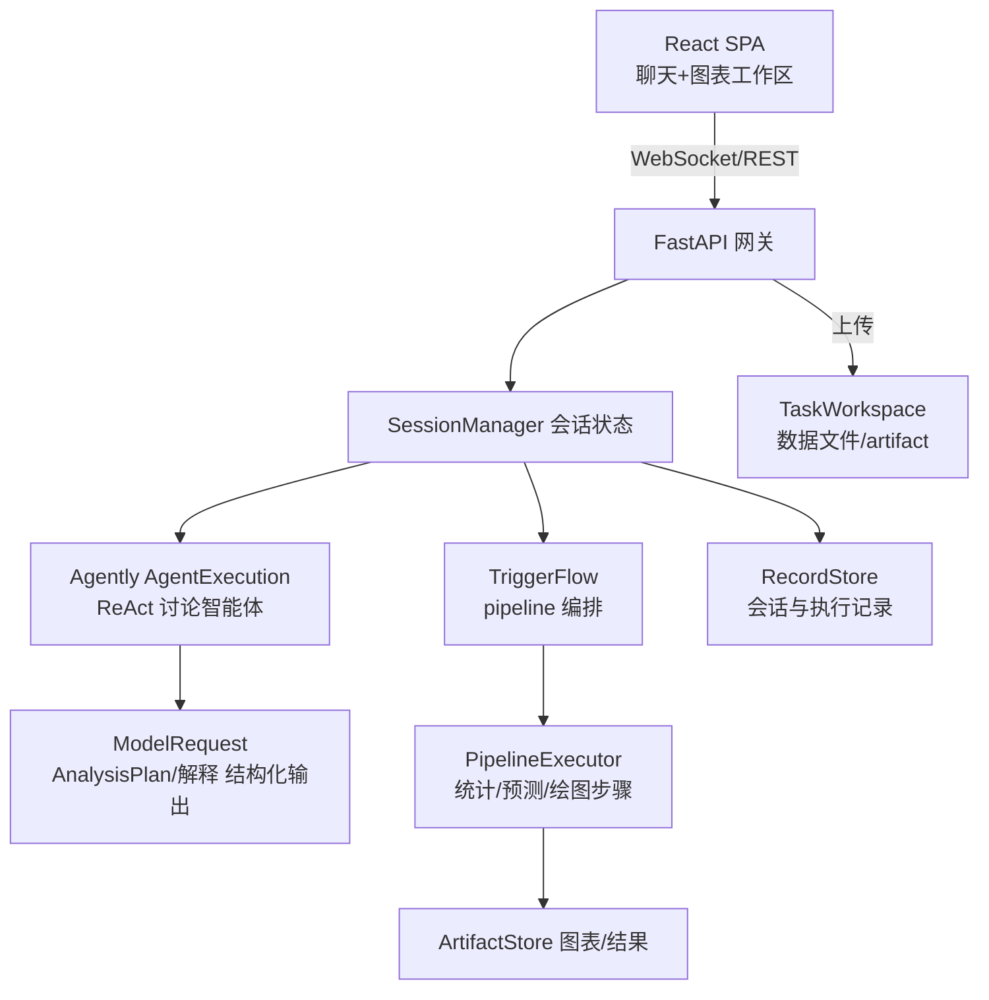

## Product Overview

MedSta：面向数据研究者的轻量级 AI 赋能数据分析智能体（Web 端）。用户上传数据后，系统解析整理数据，以 ReAct 方式与用户讨论形成分析方案（统计分析/预测/绘图），方案确定后以 pipeline 执行，反馈图表与解释建议，用户可修正方案后再次执行，最终交付图表及文字解释。开发遵循 spec 驱动 + TDD 原则。

## Core Features

- **数据接入与解析**：上传 CSV/Excel，解析类型、缺失值、统计画像，整理为可分析数据集
- **ReAct 讨论式方案设计**：智能体根据数据画像与用户诉求生成结构化分析方案（步骤、统计方法、图表类型），与用户多轮讨论确认
- **Pipeline 执行引擎**：确认后的工作流以 pipeline 顺序执行（统计计算、预测建模、绘图），产出图表与结果数据
- **解释与交付**：对执行结果生成解释与建议，用户可提修正意见触发"再讨论→再执行"循环
- **会话管理**：WebSocket 实时对话，会话与执行记录持久化，支持回溯
- **开发治理**（过程要求）：spec 生命周期目录（draft/designing/implementing/done/archived）、开发时间线、项目总体画像与设计思路文档、CODEBUDDY.md

## Visual Effect

聊天式主界面 + 数据/图表工作区：左侧会话流，右侧数据表格与交互式图表卡片，整体呈现专业数据分析工具的清爽质感。

## Tech Stack

- **后端**：Python 3（mamba 环境 `Sta`，`mamba activate Sta`）+ FastAPI（REST + WebSocket）+ Agently（OpenAI 兼容接口，自定义 base_url/api_key，可接 GLM/DeepSeek/vLLM/Ollama）
- **数据分析**：pandas（解析/统计/画像）、statsmodels/scipy（统计与预测）、matplotlib/plotly（绘图）
- **前端**：React + TypeScript + Vite + Tailwind CSS（聊天式 SPA）
- **测试**：pytest（后端 TDD，RED-GREEN 垂直切片）；模型相关测试用模拟模型/结构化契约测试，真实模型调用仅做最小验证
- **存储**：本地文件系统（会话记录 JSON/数据集文件/图表 artifact），不引入数据库（轻量原则，YAGNI）

## Implementation Approach

- **Agently owner 划分**（遵循 agently skill）：`ModelRequest` 拥有单次模型交互与方案/解释的结构化输出契约（`.input/.info/.instruct/.output` 四段式）；ReAct 讨论循环用 `AgentExecution`；pipeline 编排（讨论确认→执行→交付→再对齐）用 `TriggerFlow`；会话信息用 `TaskContext`，数据文件用 `TaskWorkspace`，会话/执行记录用 `RecordStore`。Host 代码负责 schema 校验、枚举约束与副作用，模型只做语义决策
- **TDD 流程**（遵循 tdd skill）：每个功能先写 spec → 从行为列表取第一条写测试（RED）→ 最小实现（GREEN）→ 逐条循环；测试走公共接口，仅在模型/文件系统边界 mock；不写横向切片
- **流程模型**：`DiscussionAgent`（ReAct 讨论输出 `AnalysisPlan` 结构化 JSON）→ 用户确认 → `PipelineExecutor` 按步骤执行并产出 artifact → 结果与解释回传 → 用户修正则回到讨论态
- **性能与可靠性**：数据解析在任务内一次性完成并缓存画像；绘图在后台生成文件，WebSocket 推送就绪事件；模型调用统一经 Agently settings 配置，测试默认模拟模型，避免真实 API 依赖与费用

## Architecture Design



## Directory Structure

```
/home/xdy/MedSta/
├── CODEBUDDY.md              # [NEW] CodeBuddy 工作指引（命令+架构）
├── README.md                 # [NEW] 项目简介、环境激活与启动方式
├── .gitignore / .env.example # [NEW] 环境变量样例（LLM_BASE_URL/LLM_API_KEY/LLM_MODEL）
├── docs/
│   ├── project-profile.md    # [NEW] 项目总体画像（定位、用户、能力边界、迁移考量）
│   ├── design-notes.md       # [NEW] 设计思路与关键决策记录（owner 划分、TDD 约定）
│   └── timeline.md           # [NEW] 开发时间线（按日期追加）
├── spec/
│   ├── README.md             # [NEW] 生命周期规范：draft/designing/implementing/done/archived 流转规则
│   ├── templates/spec-template.md # [NEW] spec 文档模板（目标/行为列表/验收标准/测试映射）
│   ├── draft/ designing/ implementing/ done/ archived/  # [NEW] 生命周期目录
├── backend/
│   ├── pyproject.toml        # [NEW] 依赖与 pytest 配置（pip install -e ".[dev]"）
│   ├── src/medsta/
│   │   ├── config.py         # [NEW] Agently settings 与 OpenAI 兼容 provider 配置
│   │   ├── app.py            # [NEW] FastAPI 入口（REST+WS 路由挂载）
│   │   ├── api/              # [NEW] routes_session.py / routes_data.py / ws.py
│   │   ├── session/manager.py# [NEW] 会话状态机（讨论态/执行态/交付态）
│   │   ├── agents/discussion.py # [NEW] ReAct 讨论智能体与 AnalysisPlan 契约
│   │   ├── pipeline/executor.py # [NEW] pipeline 步骤执行（stats/predict/plot）
│   │   ├── data/parser.py / profiler.py # [NEW] 数据解析与画像
│   │   └── storage/artifacts.py / records.py # [NEW] artifact 与会话记录持久化
│   └── tests/                # [NEW] pytest 测试（按模块对应，TDD 驱动）
└── frontend/                 # [NEW] Vite + React + TS + Tailwind
    └── src/ (chat/ chart/ upload/ api/ ...)
```

## Design Style

专业数据分析工作台：深靛蓝主色 + 青色数据高亮，聊天流与工作区双栏布局。左侧为会话流（消息气泡、方案卡片、执行状态时间线），右侧为可切换的表格/图表画布（卡片式、圆角、柔和阴影）。上传区支持拖拽；图表卡片悬浮展示工具栏（下载/放大）。微交互：消息渐入、pipeline 步骤进度条、状态点呼吸动画。响应式：窄屏下工作区折叠为底部抽屉。

## Agent Extensions

### Skill

- **agently**
- Purpose：确定 ModelRequest/AgentExecution/TriggerFlow/TaskContext/TaskWorkspace/RecordStore 的 owner 划分，规范方案设计、结构化输出契约与 pipeline 编排实现
- Expected outcome：后端智能体与编排代码符合 Agently 原生 owner 语义，无自定义 parser/state store 等反模式
- **agently-request**
- Purpose：设计 OpenAI 兼容 provider 的 ModelRequest 契约（AnalysisPlan/解释的结构化 output schema）
- Expected outcome：模型输入输出契约完整、可被确定性测试验证
- **agently-triggerflow**
- Purpose：实现"讨论确认→pipeline 执行→交付→再对齐"的开发者编排，含分支（修正回讨论态）与运行流
- Expected outcome：pipeline 编排可测试、可恢复，节点职责清晰
- **tdd**
- Purpose：按 RED-GREEN 垂直切片驱动每个功能的实现，行为列表驱动测试循环
- Expected outcome：pytest 测试走公共接口，每个行为先 RED 后 GREEN，无横向切片