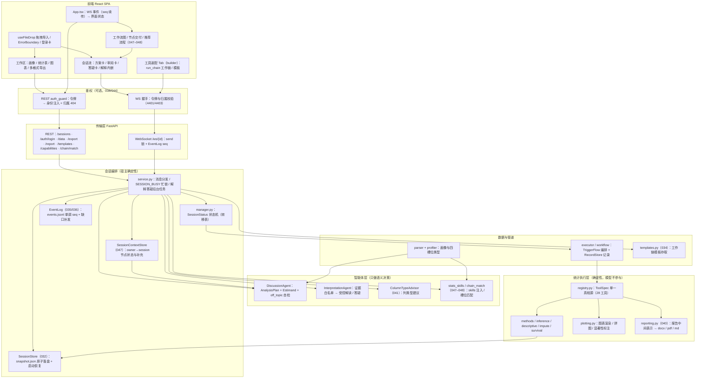
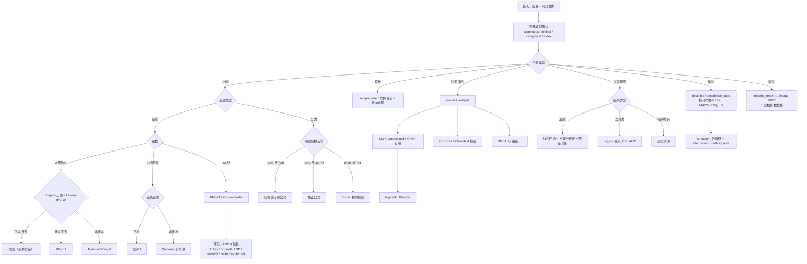
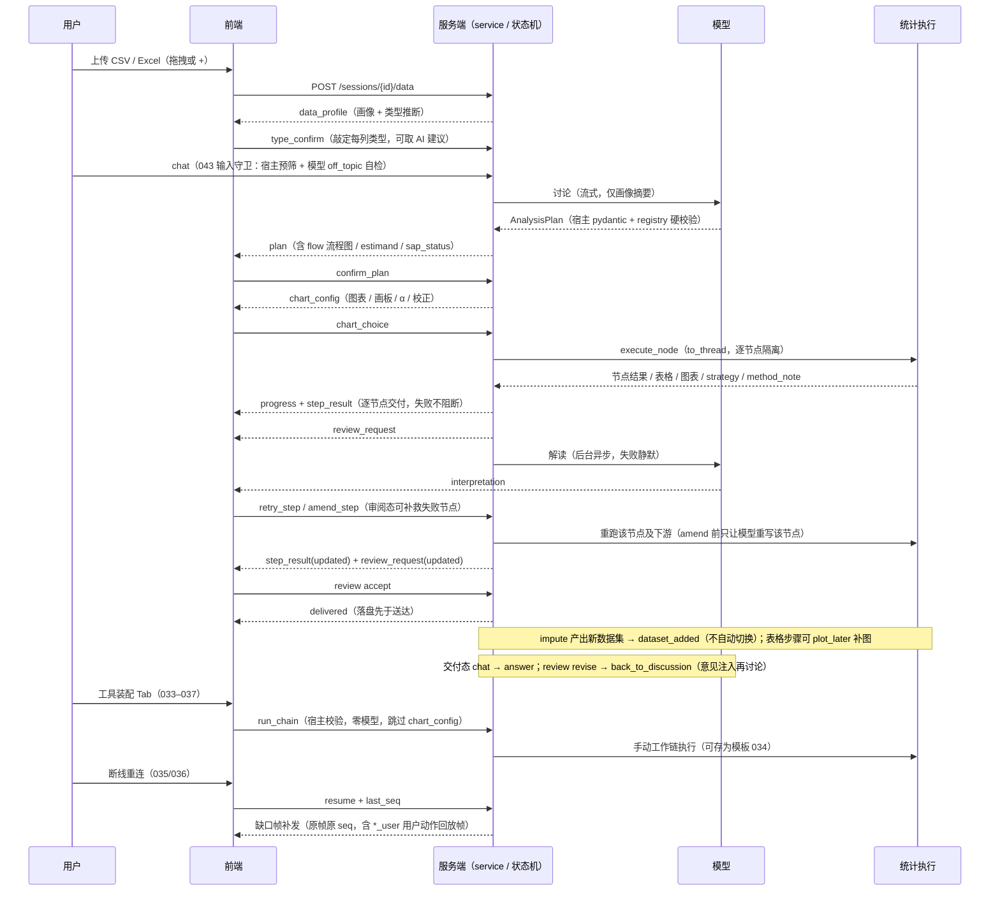

# 系统架构与统计流程

> 本文档是**三张图的唯一来源**。改动任何一张图之前，请先读它标注的依据代码——
> 架构图一旦与实际实现脱节，比没有架构图更误导。
>
> 相关文档：[产品说明](./product-guide.md) ｜ [统计说明](./statistics-methods.md) ｜ [评估基线](./evaluation-report.md)

## 1. 产品架构（分层）

**读图要点**

- 只有 `AGENT` 层调用模型；`EXEC` 层全部是确定性代码，同样的输入必得同样的输出。
- `EX1`（`stats/registry.py`）是方法、槽位、图表、适用条件的唯一真相源，新增方法只改注册表。
- 鉴权三态：未配置（匿名直通）/ `MEDSTA_AUTH_TOKEN`（单令牌）/ `MEDSTA_USERS`（多用户 + 归属隔离）；WebSocket 不经 HTTP 中间件，握手在 `api/ws.py` 内自校验。
- 持久化双通道：`SessionStore`（状态快照，重启恢复）与 `EventLog`（出站帧事件流，断线补发与消息回放）；执行记录归 Agently `LocalRecordStore`（collection=executions / sessions）。
- 节点级交付（047）：`executor` 每完成一个节点即回调 `on_step_result` → `step_result` 帧；失败节点也交付，前端可 `retry_step`（零模型重跑）或 `amend_step`（模型只重写该节点）。`SessionContextStore` 持有「图 + 进度 + 失败原因 + 用户补充」，是定点修正的上下文来源。
- 推荐流程（048）：`chain_recipes` 提供占位槽位骨架，宿主 `candidates_for` 确定性筛候选，`chain_match` 只在候选内做语义选择，最终由 `validate_step` 复核。
- 七层职责：前端呈现 → 鉴权 → 传输 → 编排（状态机 + 落盘）→ 语义决策 → 统计计算 → 数据与模板。

**依据**：`frontend/src/App.tsx`、`frontend/src/builder/`、`session/service.py`、`session/manager.py`、`session/persistence.py`、`session/events.py`、`session/templates.py`、`agents/`、`stats/registry.py`、`data/`、`pipeline/`、`reporting.py`、`api/`。

## 2. 统计策略选择

**四条主干**

1. **连续变量比较**：Shapiro → Levene（α=0.10）→ t / Welch / Mann-Whitney；配对看**差值**正态性。
2. **分类资料**：四格表按 n 与最小期望值分三档；配对四格表用 McNemar；R×C 显著后做 χ² 分割。
3. **时间-事件**：KM 估计 → log-rank/Breslow 比较 → Cox（含 PH 假设检查）→ RMST。
4. **缺失数据**：先诊断模式与机制提示，再决定完整病例 / MICE / 敏感性分析。

**降级规则**：所有分支都会写入 `strategy{steps, final_method, alternative}`，界面上可展开查看「为什么选这一步、次优是什么」。

**依据**：[统计说明 §检验策略链](./statistics-methods.md#检验策略链)、`stats/registry.py` 的 `applicability`。

## 3. 统计执行流程

**四条分支**

- **装配工作链**：`run_chain` 由用户装配（工具/参数/图表），宿主 `validate_plan` 硬校验后直接执行，全程无模型；可存为模板复用、跨机导入导出。
- **插补数据集**：`impute` 写 CSV 到工作区，推 `dataset_added`，前端追加标签页但**不切换**当前数据集。
- **交付后答疑**：`delivered` 状态下 `chat` 走答疑（只解释已交付结果，不产出新方案）；`review revise` 回讨论态，用户补充意见后重新出方案。
- **断线重连与回放**：出站帧均带单调 `seq` 落盘；`resume` 携带 `last_seq` 补发缺口帧（含用户动作帧），刷新/重启后聊天上下文可完整重建。
- **节点级接续（047）**：执行期逐节点交付（`step_result`），失败节点不阻断后续；审阅态可 `retry_step`（用户改参数、零模型）或 `amend_step`（模型只重写该节点，宿主保留 `depends_on`/`step_id`），随后重跑该节点及下游并更新同一份报告。

**依据**：[会话契约](../spec/done/006-session-api.md) 的事件清单、`session/manager.py` 的 `SessionStatus`、`session/service.py` 的消息编排、`session/events.py`。

## 4. 所有权与不变量账本（Agently）

> 模型只拥有语义决策；schema 校验、枚举约束、算术与副作用归宿主代码。
> 每一行是一个 owner 与它守护的不变量——新功能先在表中找到唯一 owner 再动手。

| Owner | 拥有 | 关键不变量 |
|---|---|---|
| `ModelRequest`（`config.ModelGateway`） | 单次模型交互与输出契约（input/info/instruct/output 四段式） | 消费字段全部在 `.output` 声明；宿主 pydantic 校验为权威；传输异常统一分类不泄漏密钥 |
| `DiscussionAgent` / `InterpretationAgent` / `ColumnTypeAdvisor` | 语义决策：方案 / 解读 / 答疑 / 列类型建议 | 证据白名单（画像摘要与结论键，不传原始数据行）；因果断言硬门（否定语境豁免）；句数截断；未核验数值标记 |
| `TriggerFlow`（`pipeline/workflow.py`） | 执行 → 审阅（pause_for）→ 路由编排 | 修正回边图可见；`to_thread` 隔离同步计算；审阅等待与执行兜底超时分离 |
| `LocalRecordStore` | 执行记录与消息记录（collection=executions/sessions） | 按 `scope.session_id` 查询；accept 交付后落库 |
| `SessionStatus`（`session/manager.py`） | 会话状态机 | 转移表强约束；跨重启恢复不走转移表，`executing` 一律降级为 `discussing` |
| `SessionStore`（032） | 会话快照 | 只存重建所需最小状态；原子写；落盘先于送达 |
| `EventLog`（035/036） | 出站帧事件流 | 单调 seq 续接不回退；缺口补发不重复投递；用户动作帧占 seq 不实时广播 |
| `SessionContextStore`（047） | 会话上下文（owner→session）：工作流图、节点状态、失败原因、用户补充 | 只放可安全注入模型的最小事实，不放原始数据行；`snapshot()` 有长度上限；删除会话即释放 |
| `plan_flow` / `chain_recipes` / `stats_skills`（047–048） | 流程图生成、推荐流程骨架、方法学规则 | 依赖只允许指向更早节点（缺失补线性链）；候选列由宿主确定性筛出，模型只在候选内选择；skills 只提示，拦截仍归 `validate_step` |
| `stats/registry.py` | 方法 / 槽位 / 图表 / 适用条件单一真相源 | 新增方法只改注册表；附录 A 与 tools.md 与之严格同源（B1/B7 守护） |
| 鉴权中间件 + WS 握手（038/044） | 身份注入与归属隔离 | 令牌 → username；非 owner 一律 404/4403 不泄露存在性；未配置时零行为变化 |
| 宿主输入守卫（043） | 闲聊预筛 | 明显闲聊零 token 拒绝；可疑输入交模型自检（off_topic），语义判断仍归模型 |

**依据**：`docs/design-notes.md` 的 Owner 划分、`config.py`、`agents/`（含 `flow.py` / `stats_skills.py` / `chain_recipes.py` / `chain_match.py`）、`pipeline/workflow.py`、`session/`（含 `context.py`）、`stats/registry.py`、`api/ws.py`。

## 附录 A：工具清单（28）

> 本表与 `stats/registry.py` 的 `_REGISTRY` 严格同源，由 `tests/test_docs_consistency.py::test_appendix_tools_match_registry` 守护。
> 新增方法时同步此表，否则测试失败。

| 工具 | 类别 | 必填槽位 | 图表 |
|---|---|---|---|
| `describe` | 描述与质检 | — | histogram / boxplot / violin / pie |
| `descriptive_stats` | 描述与质检 | — | histogram / boxplot / violin |
| `reference_range` | 描述与质检 | — | — |
| `missing_report` | 描述与质检 | — | — |
| `impute` | 描述与质检 | — | — |
| `dedupe` | 数据清洗 | — | — |
| `filter_rows` | 数据清洗 | — | — |
| `standardize` | 数据清洗 | — | — |
| `bin_column` | 数据清洗 | — | — |
| `outlier_report` | 数据清洗 | — | — |
| `winsorize` | 数据清洗 | — | — |
| `normality_test` | 描述与质检 | — | qq_plot / histogram |
| `levene_test` | 描述与质检 | group_column | boxplot |
| `aggregate_table` | 描述与质检 | group_column | grouped_bar / pie / bar |
| `group_compare` | 组间比较 | group_column | boxplot / violin |
| `one_sample_test` | 组间比较 | mu0 | histogram / boxplot |
| `anova` | 组间比较 | group_column | boxplot / grouped_bar / violin |
| `randomized_block_anova` | 组间比较 | group_column / block_column | boxplot / grouped_bar |
| `factorial_anova` | 组间比较 | factor_a / factor_b | grouped_bar / boxplot |
| `repeated_measures_anova` | 组间比较 | subject_column / within_column | line / boxplot |
| `chi_square` | 组间比较 | — | grouped_bar / heatmap |
| `mcnemar_test` | 组间比较 | — | grouped_bar |
| `survival_analysis` | 组间比较 | time_col / event_col | survival_curve |
| `sample_size` | 研究设计 | — | — |
| `correlation` | 关联与预测 | — | heatmap / scatter |
| `regression` | 关联与预测 | target / features | residual_plot / scatter |
| `logistic_regression` | 关联与预测 | target / features | bar / grouped_bar |
| `timeseries_forecast` | 关联与预测 | — | line |

## 附录 B：事件与状态对照

> 出站事件均经 `EventLog` 分配单调 `seq` 落盘（035），断线重连按 `last_seq` 补发（035/036）。

| 事件（服务端 → 客户端） | 触发时机 | 前端动作 |
|---|---|---|
| `data_profile` | 上传完成、切换工作区 | 建立/更新工作区，切换 active |
| `type_review` | 画像后待敲定类型（讨论前置门控） | 展示类型确认卡 |
| `column_type_suggestions` | AI 列类型建议（041） | 建议徽标 + 单列/全部采纳 |
| `type_confirmed` | 用户敲定列类型 | 更新画像表 |
| `chat_rejected` | 输入守卫拒绝（043） | notice 气泡引导描述统计需求 |
| `stream` / `progress` | 讨论流式增量 / 阶段与步骤进度 | 思考展示 / 进度条 |
| `plan` | 方案生成完成 | 渲染方案卡（含估计目标） |
| `chart_config` | 确认方案后（含图步骤） | 展示出图配置卡 |
| `step_result` | 每个工作节点完成（含失败节点，047） | 节点级交付：逐节点渲染结果/错误，可重试或定点修正 |
| `review_request` | 执行完成（或补图更新） | 渲染审阅卡 |
| `interpretation` | 解读生成（后台异步，失败静默） | 补进最后一条审阅卡 |
| `dataset_added` | impute 产出数据集 | 追加标签页，不切换 |
| `workspace_outputs_cleared` | 清空工作台既往产出（保留导入表格） | 清空图表与统计表交付，保留画像 |
| `plot_suggest` | 表格型步骤可补图 | 展示补图入口（plot_later） |
| `answer` | 交付态答疑 | 渲染答疑卡 |
| `back_to_discussion` | 修正回讨论 | 回讨论输入态 |
| `delivered` | 用户确认交付 | 审阅卡转为已交付 |
| `interrupted` / `resumed` | 中断生效 / 重连或页面恢复 | 停止进度 / 按阶段还原界面 |
| `error` | 任何失败（code/message/hint/detail） | 分类错误提示 |
| `{type}_user`（回放帧） | 用户动作入事件流（036，仅补发） | 重建用户气泡 |

入站事件（客户端 → 服务端）中与节点级交付配套的两个（047）：`retry_step {index, overrides}` 重跑该节点及其下游、`amend_step {index, note}` 让模型按用户补充只重写这一个节点。

| 状态（`SessionStatus`） | 含义 | 允许转移 |
|---|---|---|
| `DISCUSSING` | 讨论中，可修改方案 | `PLAN_CONFIRMED` / `EXECUTING` / 自身 |
| `PLAN_CONFIRMED` | 方案已确认（出图配置暂停点） | `EXECUTING` / `DISCUSSING` |
| `EXECUTING` | 执行中 | `DELIVERED` / `DISCUSSING` |
| `DELIVERED` | 已交付，chat 走答疑 | `DISCUSSING` / 自身 |
