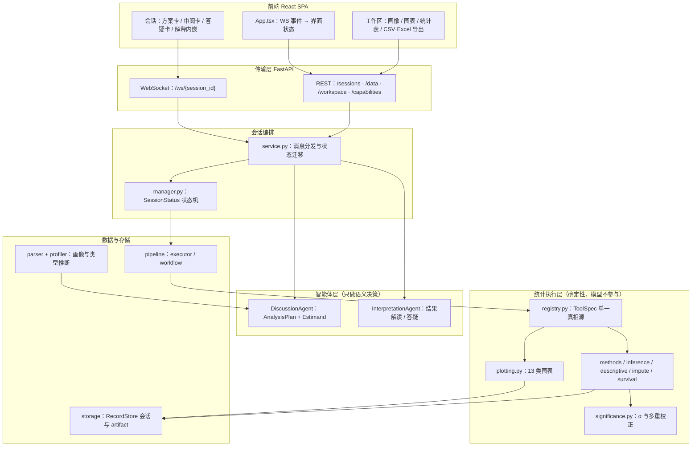
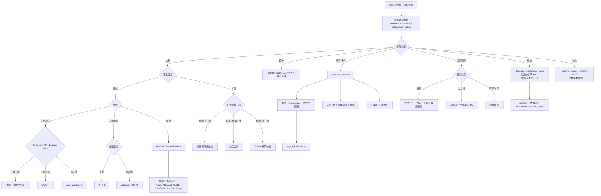
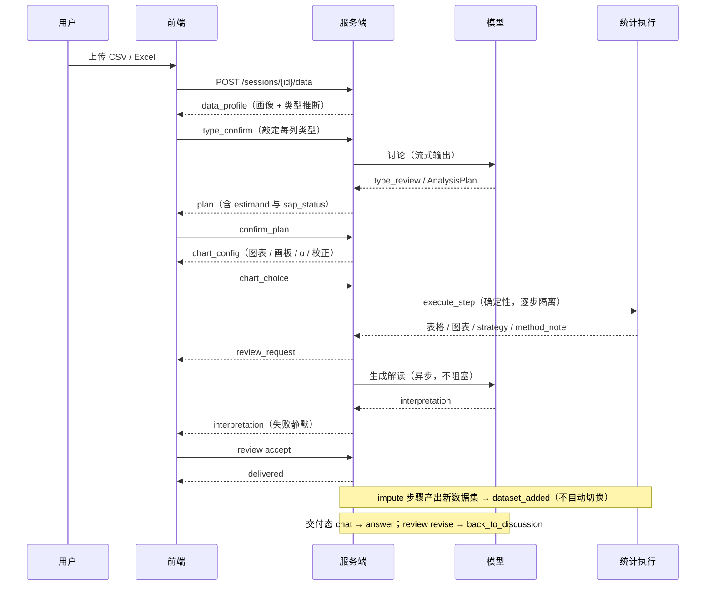

# 系统架构与统计流程

> 本文档是**三张图的唯一来源**。改动任何一张图之前，请先读它标注的依据代码——
> 架构图一旦与实际实现脱节，比没有架构图更误导。
>
> 相关文档：[产品说明](./product-guide.md) ｜ [统计说明](./statistics-methods.md) ｜ [评估基线](./evaluation-report.md)

## 1. 产品架构（分层）

**读图要点**

- 只有 `AGENT` 层调用模型；`EXEC` 层全部是确定性代码，同样的输入必得同样的输出。
- `EX1`（`stats/registry.py`）是方法、槽位、图表、适用条件的唯一真相源，新增方法只改注册表。
- 六层职责：前端呈现 → 传输 → 编排（状态机）→ 语义决策 → 统计计算 → 数据与落盘。

**依据**：`frontend/src/App.tsx`、`session/service.py`、`session/manager.py`、`agents/`、`stats/registry.py`、`data/`、`pipeline/`、`storage/`。

## 2. 统计策略选择

**四条主干**

1. **连续变量比较**：Shapiro → Levene（α=0.10）→ t / Welch / Mann-Whitney；配对看**差值**正态性。
2. **分类资料**：四格表按 n 与最小期望值分三档；配对四格表用 McNemar；R×C 显著后做 χ² 分割。
3. **时间-事件**：KM 估计 → log-rank/Breslow 比较 → Cox（含 PH 假设检查）→ RMST。
4. **缺失数据**：先诊断模式与机制提示，再决定完整病例 / MICE / 敏感性分析。

**降级规则**：所有分支都会写入 `strategy{steps, final_method, alternative}`，界面上可展开查看「为什么选这一步、次优是什么」。

**依据**：[统计说明 §检验策略链](./statistics-methods.md#检验策略链)、`stats/registry.py` 的 `applicability`。

## 3. 统计执行流程

**三条分支**

- **插补数据集**：`impute` 写 CSV 到工作区，推 `dataset_added`，前端追加标签页但**不切换**当前数据集。
- **交付后答疑**：`delivered` 状态下 `chat` 走答疑（只解释已交付结果，不产出新方案）。
- **修正回讨论**：`review {decision:"revise"}` 回到讨论态，用户补充意见后重新出方案。

**依据**：[会话契约](../spec/done/006-session-api.md) 的事件清单、`session/manager.py` 的 `SessionStatus`。

## 附录 A：工具清单（22）

> 本表与 `stats/registry.py` 的 `_REGISTRY` 严格同源，由 `tests/test_docs_consistency.py::test_appendix_tools_match_registry` 守护。
> 新增方法时同步此表，否则测试失败。

| 工具 | 类别 | 必填槽位 | 图表 |
|---|---|---|---|
| `describe` | 描述与质检 | — | histogram / boxplot / violin / pie |
| `descriptive_stats` | 描述与质检 | — | histogram / boxplot / violin |
| `reference_range` | 描述与质检 | — | — |
| `missing_report` | 描述与质检 | — | — |
| `impute` | 描述与质检 | — | — |
| `normality_test` | 描述与质检 | — | qq_plot / histogram |
| `levene_test` | 描述与质检 | group_column | boxplot |
| `aggregate_table` | 描述与质检 | group_column | grouped_bar / pie / bar |
| `group_compare` | 组间比较 | group_column | boxplot / violin |
| `one_sample_test` | 组间比较 | mu0 | histogram / boxplot |
| `anova` | 组间比较 | group_column | boxplot / grouped_bar / violin |
| `randomized_block_anova` | 组间比较 | group_column / block_column | boxplot / grouped_bar |
| `factorial_anova` | 组间比较 | factor_a / factor_b | grouped_bar / boxplot |
| `repeated_measures_anova` | 组间比较 | subject_column / within_column | line / boxplot |
| `chi_square` | 组间比较 | — | grouped_bar / heatmap |
| `mcnemar_test` | 组间比较 | — | grouped_bar |
| `survival_analysis` | 组间比较 | time_col / event_col | survival_curve |
| `sample_size` | 研究设计 | — | — |
| `correlation` | 关联与预测 | — | heatmap / scatter |
| `regression` | 关联与预测 | target / features | residual_plot / scatter |
| `logistic_regression` | 关联与预测 | target / features | bar / grouped_bar |
| `timeseries_forecast` | 关联与预测 | — | line |

## 附录 B：事件与状态对照

| 事件（服务端 → 客户端） | 触发时机 | 前端动作 |
|---|---|---|
| `data_profile` | 上传完成、切换工作区 | 建立/更新工作区，切换 active |
| `type_review` | 画像后待敲定类型 | 展示类型确认卡 |
| `plan` | 方案生成完成 | 渲染方案卡（含估计目标） |
| `chart_config` | 确认方案后 | 展示出图配置卡 |
| `review_request` | 执行完成 | 渲染审阅卡 |
| `interpretation` | 解读生成（异步） | 补进最后一条审阅卡 |
| `dataset_added` | impute 产出数据集 | 追加标签页，不切换 |
| `answer` | 交付态答疑 | 渲染答疑卡 |
| `delivered` | 用户确认交付 | 审阅卡转为已交付 |

| 状态（`SessionStatus`） | 含义 |
|---|---|
| `DISCUSSING` | 讨论中，可修改方案 |
| `EXECUTING` | 执行中 |
| `AWAITING_REVIEW` | 待审阅 |
| `DELIVERED` | 已交付，chat 走答疑 |
